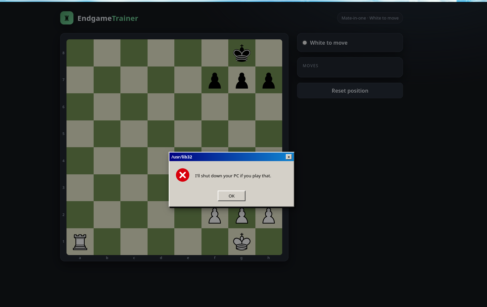
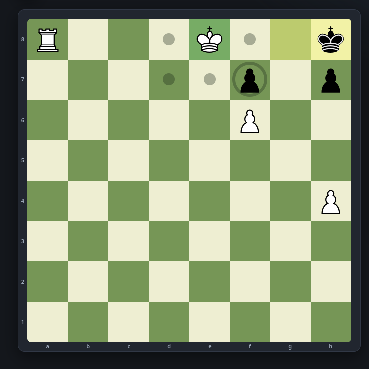
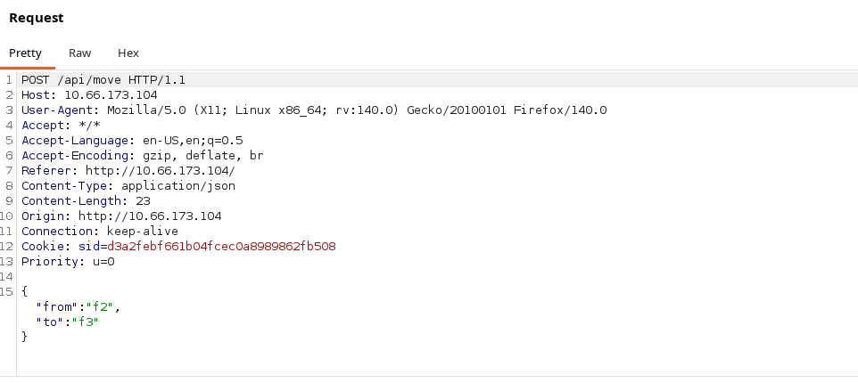
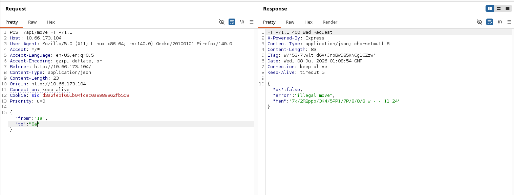
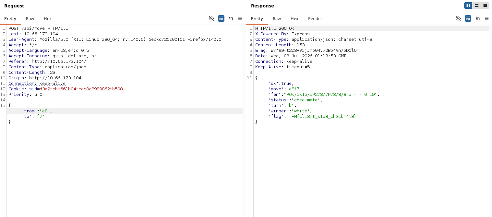
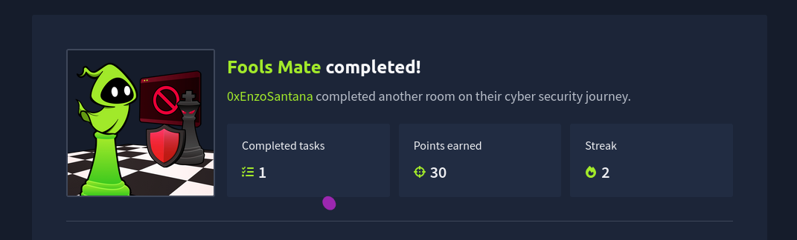

# THM-FoolsM8_Level1

Bom, nessa maquina não precisamos de recon nem nada do tipo, o objetivo dela é bem claro, manipular os valores controlados da partida de xadrez, nesse jogo, qualquer movimento com  alto risco de vitoria resulta em um erro pra manipular a vitoria do bot.

tentei ir ao maximo mais longe jogando sem mexer na maquina, mas cada vez que fica proximo de ganhar o jogo trava no lugar do erro 

dado isso, abri o burpsuite e peguei a request da jogada e comecei a analisar ela, vemos que tudo é feito por uma api e dentro do body temos from que é onde nossa peça esta, e o to, que é onde nossa peça será movida.

Nesse temos um request de um movimento bloqueado, não tem nada de mais nele

Mas ao editamos os valores de from e to, o servidor nos retorna a flag, bem facilmente, esse ctf é extremamente simples, e por isso ele é feito em duas partes, em um writeup futuro trarei a parte 2 dele. 

gg. 

